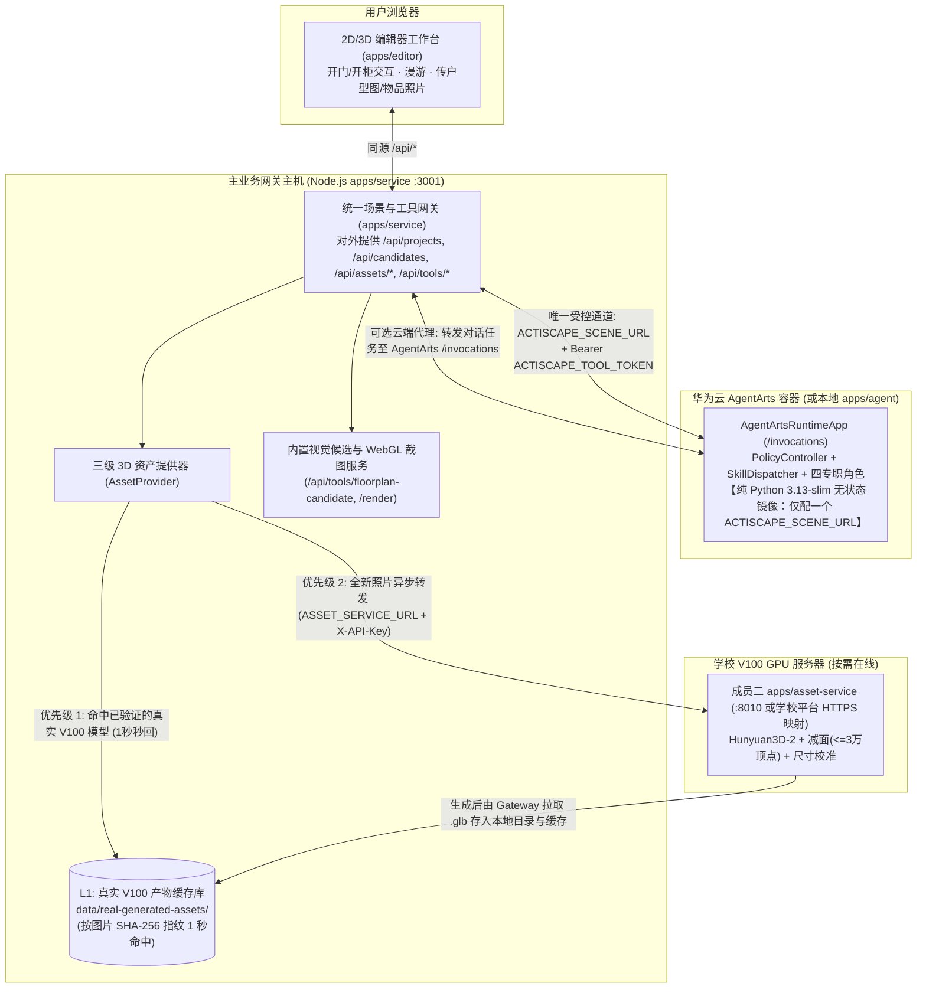
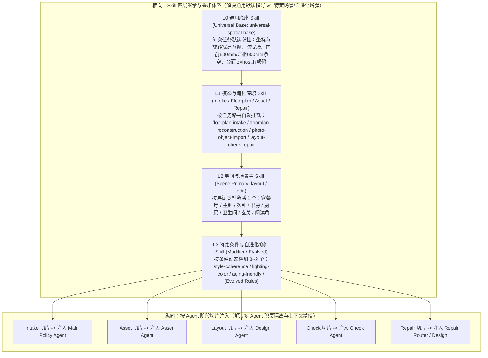
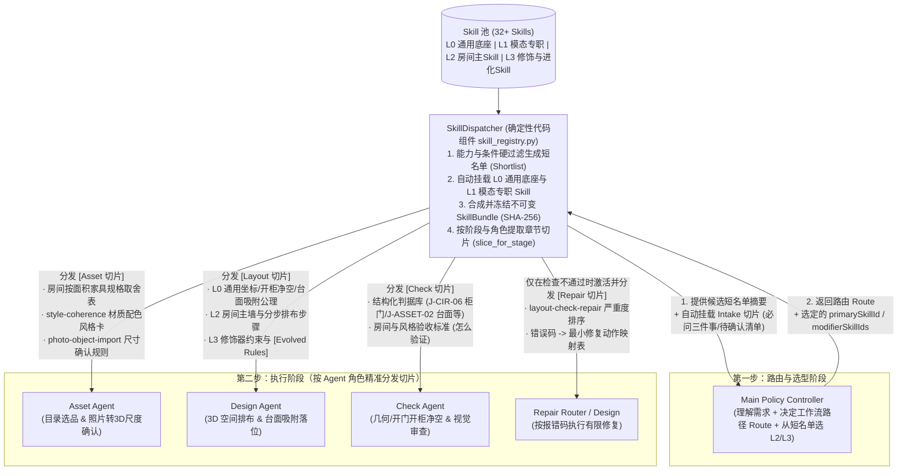
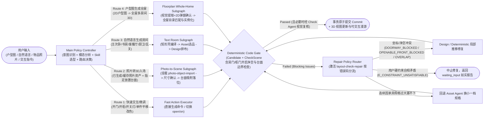

# ActiScape 下一阶段架构决议与详细执行计划（1110 计划 · 完整权威版）

> **致后续接手执行本计划的 Agent（Handoff Notice）**
> 本文件是 **2026-11-10** 经过全局架构复核、产品方向校准、成员二（`origin/dev/assets`）代码审计、Skill 池与自进化机制深挖、多智能体 Policy 编排设计以及**华为云 AgentArts 上云适配**对齐后的**唯一权威执行蓝图**。
> - **严格执行边界**：当你被指派执行本文件中的某一个阶段（`P0`、`P1`、`P2`、`P3` 或 `P4`）时，请**先完整阅读第 0 部分（交接上下文与红线约束）和第 1～5 部分（核心架构决议与图表）**，再严格按照**第 6 部分（分阶段可执行开发任务单）**对应阶段的文件级清单与验收命令推进开发。
> - **给成员二 Agent 的指令**：已完整收录在 **第 2.4 节**，可直接复制发送给成员二的 Agent 执行。

---

## 目录（Table of Contents）

- **第 0 部分：执行 Agent 交接必读（Handoff Context、分支拓扑、核心代码地图与红线约束）**
- **第 1 部分：核心产品定位、全屋多房间扩展与 3D 可交互动作/净空检验决议**
  - 1.1 为什么此前局限于“客餐厅”？如何快速扩展到全屋多房间？
  - 1.2 支撑关系与物理仿真 vs. 可交互 3D 动作（开门/关门、开柜门/抽屉）与空间合理性检验
  - 1.3 五大参考项目（`house-plan-designer` / `SceneSmith` / `SceneMosaic` / `ACRScene` / `Code-as-Room`）核心借鉴映射表
- **第 2 部分：成员二（`origin/dev/assets`）照片转 3D 服务深度审计、最佳调用架构与给成员二 Agent 的改造提示词**
  - 2.1 成员二分支现状与 V100 实测花瓶产物（`5a775fe0`）深度审计
  - 2.2 成员二服务怎么调用最合适？（统一网关代理 + 三级资产提供器 + 两段式非阻塞入场架构图）
  - 2.3 双方协同改造清单（成员二 5 项 + 我方主系统 4 项）
  - 2.4 【可直接复制】发给成员二 Agent 的精确代码改造提示词
- **第 3 部分：Skill 池深度设计（现有 32 个 Skill 剖析、相关项目与自进化形态、双维矩阵与 `SkillDispatcher` 分发机制）**
  - 3.1 仓库现有 32 个 Skill 与 40+ 条判据库现状解剖及三大断层
  - 3.2 相关项目调研与自进化（Self-Evolution / GEPA）产出的 Skill 具体形态（附实例）
  - 3.3 系统 Skill 的四层分类与“横向继承 × 纵向阶段切片”双维架构图
  - 3.4 通用 Skill 会影响系统编排流程吗？（控制流与知识流解耦原则）
  - 3.5 谁来接手并分发 Skill？（`SkillDispatcher` 面向 Policy 与各专职 Agent 的切片分发流程图）
- **第 4 部分：多智能体系统编排模式（外层 `PolicyController` 动态路由 + 内层确定性代码门禁子图）**
  - 4.1 固定工作流 vs. Policy 动态控制的取舍结论
  - 4.2 多智能体有界策略路由状态图（Bounded Policy-Routed StateGraph 架构图）
- **第 5 部分：面向华为云 AgentArts（ModelArts Versatile）的全系统无状态上云架构**
  - 5.1 华为云 AgentArts 运行时约束与现有 `deploy/agentarts-minimal` 差距分析
  - 5.2 单一受控网关（`ACTISCAPE_SCENE_URL`）与无状态容器化上云架构图
- **第 6 部分：分阶段可执行开发任务单（`P0` ~ `P4` 五个阶段，精确到文件、函数、字段契约与验收命令）**

---

## 第 0 部分：执行 Agent 交接必读（Handoff Context & Redlines）

### 0.1 项目核心愿景与当前最高优先级
本项目的核心竞争力是：**让用户能够极快地从一张 2D 户型图、一句自然语言想法（Idea），或者附带一张真实物品照片，转化为一个可看、可第一人称漫游、可交互（开门/关门、开柜门/抽屉、开关灯/电视/窗帘）的全屋 3D 场景，并能无缝部署运行在华为云 AgentArts 平台上**。
其中，“可交互 3D 动作”兼具两大核心价值：
1. **一是通过动作进一步检查场景布局是否合理**：例如通过打开房门、打开衣柜门/橱柜门/电视柜门/抽屉，直观且定量地检查门扇或柜门开启时是否会撞到床、茶几、餐桌椅等周边家具（即“动作包络净空检测”）。
2. **二是大幅提升 3D 场景的漫游体验与交互性**：支持用户在 3D 轨道视图或第一人称漫游（`漫游`模式）中直接点击/按 `E` 键开关门、开关柜子、开关灯具与窗帘，或通过工具栏/对话指令“一键开启全部门和柜门检验布局”。

### 0.2 当前明确暂缓/不做的事项（防止方向跑偏）
1. **暂不做重型刚体物理引擎（Rigid-Body Physics）与地震模拟**：不引入 Cannon.js / Rapier 等动力学引擎，不计算重力下落碰撞或地震摇晃；仅做**轻量化几何台面吸附（Surface Snap：$z = z_{\text{host}} + h_{\text{host}}$）**与**开门/开柜门动作包络净空冲突检测**。
2. **暂缓外层 GEPA 自动化进化训练闭环**：先把内层全屋场景生成、3D 交互与净空检验、成员二照片转 3D 置入、Skill 分发器（`SkillDispatcher`）和华为云 AgentArts 适配做扎实；但 Skill 池结构已严格按支持自进化的三形态留好标准挂载槽位。
3. **不拆分普通用户与初级设计师双产品线，统一功能入口优先级**：
   - **第一优先级**：从 2D 户型图生成全屋 3D 场景（`reconstruct_floorplan`）；
   - **第二优先级**：通过自然语言描述生成/局部修改全屋各类型房间（`generate_rectangular` / `edit`）+ 上传单张物品照片转为 3D 模型放入场景中（`photo_to_scene`）。

### 0.3 仓库拓扑与多分支现状
- **工作区根路径**：`/workspace/3D-design-agent`
- **上游参考项目路径**：`/workspace/house-plan-designer-reference`（上游 `ZWD11/house-plan-designer@b94183f9` 源码参考）
- **核心分支拓扑**：
  1. `dev/core`（当前所在主干开发分支，最新提交 `d3fc5d2`）：包含 `packages/scene-core`、`packages/vision-adapter`、`apps/service`、`apps/agent`、`apps/editor`、`deploy/agentarts-minimal`。
  2. `origin/dev/assets`（成员二分支，最新提交 `8552b78`）：已实现 `apps/asset-service`（FastAPI + `Hunyuan3D-2` 单图转 `.glb` 服务），已在学校 Tesla V100-32GB 服务器跑通首个真实花瓶资产（`5a775fe0-4b15-4e54-9bab-87b6146773dd`）。**注意：`origin/dev/assets` 从初始提交 `da793c6` 分叉且修改了根 `README.md`，切勿直接 `git merge`，应按 P2 阶段选择性检出 `apps/asset-service/` 与 `docs/member2-*`**。
  3. `origin/dev/skills-deploy`（成员三分支）：其 30 个 Skill 内容与 `deploy/agentarts-minimal` 已合入 `dev/core` 的 `apps/agent/actiscape_agent/skills/` 中，后续直接在 `dev/core` 演进。

### 0.4 核心代码地图（Key File Map）
| 模块 | 关键文件 | 职责说明 |
| :--- | :--- | :--- |
| **几何与规则内核 (`scene-core`)** | `packages/scene-core/src/index.ts` | 核心数据结构、目录 `catalog`（266 个参数化家具配方）、几何计算、`detectRooms`、`checkScene`（门洞净空、碰撞、通行宽度等确定性检查） |
| | `packages/scene-core/src/placement.ts` | 家具朝向、墙面吸附、语义放置辅助 |
| | `packages/scene-core/src/rectangular.ts` | 自然语言矩形房间结构编译（`compileRectangular`）与初始化检查（`checkInitialization`） |
| | `packages/scene-core/src/floorplan.ts` | 户型图识别结构（`FloorplanData` V3/V4）、比例尺求解、全屋编译（`compileFloorplan` / `materializeFloorplan`） |
| | `packages/scene-core/src/scene-program.ts` | 统一场景中间表示 `SceneProgram v1`（含 `levels`、`objects`、`placement: "floor"\|"wall"\|"surface"\|"ceiling"`、`parentObjectId`、`z`） |
| | `packages/scene-core/src/scene-contracts.ts` | `SceneDraft v2` 契约（含 `InputBundle`、`EvidenceGraph`、`IntentSpec`、`AssetResolution`） |
| **主业务与工具网关 (`service`)** | `apps/service/src/app.ts` | Fastify REST API 总入口（`/api/projects`、`candidates`、`scene-drafts`、`assets`、`tasks`），**也是华为云 AgentArts 唯一调用的受控外部工具网关（`ACTISCAPE_SCENE_URL`）** |
| | `apps/service/src/assets.ts` | 自定义 `.glb` 资产校验（`inspectGlb`）、尺寸校准、入库与三级资产提供器（缓存/远端GPU/Demo） |
| | `apps/service/src/candidates.ts` | 候选方案生成、预检与事务提交门禁 |
| **多智能体与 Skill (`agent`)** | `apps/agent/actiscape_agent/workflow.py` | LangGraph 主工作流编排（`PolicyController` + 子图路由 + 门禁修复闭环） |
| | `apps/agent/actiscape_agent/scene-registry.v1.json` | 场景注册表（15 类房间定义与 32 类家具目录映射） |
| | `apps/agent/actiscape_agent/skill_registry.py` | Skill 池加载、短名单筛选、合成冻结与按阶段切片分发（`SkillDispatcher`） |
| | `apps/agent/actiscape_agent/skills/` | 32 个 Skill 包（`manifest.json` + `SKILL.md`）与结构化判据库 `_framework/judgements.v1.json` |
| | `apps/agent/actiscape_agent/roles.py` | LLM/VLM 调用封装、确定性布局与修改兜底逻辑 |
| | `apps/agent/actiscape_agent/generation_flow.py` | 自然语言生成房间子流程 |
| | `apps/agent/actiscape_agent/floorplan_flow.py` | 户型图转 3D 场景子流程（V3/V4） |
| **前端 2D/3D 编辑器 (`editor`)** | `apps/editor/src/views/three-view.ts` | Three.js 3D 渲染、门窗构建（已支持 `o.open`）、第一人称漫游 `walk()`、3D 射线点击/按键交互 |
| | `apps/editor/src/modeling/furniture-3d.js` | 全部程序化家具 3D 网格生成（柜体 `TD`/`_D`、衣柜、床、桌椅、家电、灯具/窗帘 `opt.on`）及外部 `.glb` 加载 |
| | `apps/editor/src/ui/inspector.ts` | 右侧属性面板（门/柜开启开关、家具尺寸/高程/电器开关、照片转 3D 入口） |
| | `apps/editor/src/ui/chat.ts` | 底部/侧边 Agent 对话与多模态任务发起面板 |
| **华为云 AgentArts (`deploy`)** | `deploy/agentarts-minimal/agent.py` | 基于 `agentarts.sdk.AgentArtsRuntimeApp` 的 `/invocations` 云端运行时入口与 `Dockerfile` |

### 0.5 不可破坏的架构红线与回归基准命令
1. **单写口事务门禁红线**：任何 Agent 角色、Skill 或外部视觉/3D 资产服务**严禁直接修改正式 `Project`**。一切变更必须先生成 `Candidate`，通过 `checkScene` / `checkCandidate` 确定性几何门禁，再经 `commit` 提交并递增 `revision`。
2. **单位与坐标系红线**：`scene-core` 与 `SceneProgram` 内部统一使用 **毫米（`mm`）**；Three.js 渲染层（`three-view.ts` / `furniture-3d.js`）使用 **米（`m`，即 `mm / 1000`）**，且 `+Y` 为垂直向上高程轴。
3. **云原生无状态红线（面向华为云 AgentArts）**：`apps/agent` 不得新增任何强依赖本地 GPU、本地 Node.js 子进程或仅保存在容器临时磁盘上的业务状态；所有持久化场景、草稿、截图渲染、像素分析与 3D 资产必须通过 `SceneClient`（即 `ACTISCAPE_SCENE_URL` 指向的 `apps/service`）完成。
4. **每次修改后必须通过的基准测试命令**：
   ```bash
   npm run test:all
   ```

---

## 第 1 部分：核心产品定位、全屋多房间扩展与 3D 可交互动作/净空检验决议

### 1.1 为什么此前局限于“客餐厅”？如何快速扩展到全屋多房间？
通过对代码库的深度排查，系统此前只能生成“客餐厅/阅读会客间”并非底层 3D 引擎不支持，而是被**两处人为门禁/瓶颈**卡住了：

1. **自然语言生成路径（`generate_rectangular`）—— 注册表开关未解锁**：
   - 在 `apps/agent/actiscape_agent/scene-registry.v1.json`（第 39–214 行）与 `apps/agent/actiscape_agent/skills/index.v1.json` 中，**主卧（`master_bedroom`）、次卧（`guest_bedroom`）、儿童房（`kids_room`）、婴儿房（`nursery`）、书房（`study`）、厨房（`kitchen`）、卫生间（`bathroom`）、玄关（`entry`）、阳台（`balcony`）** 的默认家具配方、地面/墙面材质、Skill 文档与全套 32 类程序化 3D 网格（`furniture-3d.js`）**早已写好**！
   - 唯一阻断原因是这些房间在 `scene-registry.v1.json` 中被标为 `"status": "reserved"`，被 `generation_schemas.py:78` 拦截。
   - **破局方案**：在 `P1` 阶段直接将 `master_bedroom`、`guest_bedroom`、`study`、`kitchen`、`bathroom`、`entry` 切换为 `"active"`，并在 `roles.py` 中补齐对应房间的确定性排布兜底（床靠主墙、双床头柜贴床、衣柜留开门通道、书桌配书椅等），即可在极小改动下将文字生成从 2 类房间扩展至 **8 类全屋核心房间**。
2. **户型图生成全屋路径（`reconstruct_floorplan`，第一优先级入口）—— 被零人工干预像素规则卡住**：
   - 底层编译器 `packages/scene-core/src/floorplan.ts`（V4 模式）与 3D 渲染器 `three-view.ts` **已经完全支持全屋多房间同时生成 3D 墙体、门窗与全屋家具**。
   - 真正卡点在于 `packages/vision-adapter` 的 `hpd-adapter` 试图仅凭传统像素连通域规则在复杂栅格户型图上做到“100% 零人工干预全自动识别”（导致墙体召回率仅 `8.97%`），且旧流程默认只把 `living`/`dining` 塞进 `targetRoomIds`。
   - **破局方案**：
     - 将 `targetRoomIds` 默认策略升级为**“默认勾选全屋所有已识别功能房间（客厅、餐厅、主次卧、书房、厨房、卫生间、玄关、阳台）”**；
     - 采用 **“VLM 拓扑辅助 + 2D 确认弹窗轻量化半自动标定”**：允许用户在前端已有的户型确认弹窗（`apps/editor/src/main.ts`）中一键全选全屋房间、快速确认比例尺与门向，几秒钟内即可编译出可漫游的全屋多房间 3D 场景。

---

### 1.2 支撑关系与物理仿真 vs. 可交互 3D 动作（开门/关门、开柜门/抽屉）与空间合理性检验
**专家决议：当前阶段完全不需要刚体物理引擎（Gravity / Rigid-Body Physics）或地震模拟**。对于室内 3D 场景生成与漫游而言，最核心的是**通过构件的“开关动作”检验空间布局是否合理、通过“表面高程吸附”让小物件稳稳摆在桌面上**：

| 能力维度 | 为什么不做重型物理仿真 | 我们要落地的“可交互几何动作与合理性检验”方案 |
| :--- | :--- | :--- |
| **开门/关门交互与检验** | 门扇是否撞家具、能否通行是几何包络问题，无需刚体碰撞动力学 | **已有基础增强**：`three-view.ts`（第 553–631 行）已支持 `o.open`（平开门旋转 90°、双开门、推拉门平移、折叠门折叠，且第一人称漫游 `walk()` 在门关时阻挡、门开时允许走过）。在 `P0` 阶段新增 **3D 视图双击/漫游按 `E` 键直接开关门** 及 **门扇开启 800mm 弧线净空高亮**。 |
| **开柜门/抽屉交互与检验** | 衣柜门打不开撞床、电视柜抽屉拉不开撞茶几，属于动作开启包络（Action Envelope）干涉 | **新增核心亮点**：在 `furniture-3d.js` 为衣柜（`wardrobe*`）、电视柜（`tvCabinet`）、储物柜/鞋柜/橱柜（`cab*`、`TD`/`_D`）、床头柜（`nightstand`）、书桌抽屉（`desk`）、冰箱（`fridge`）增加 `opt.open` 状态（平开柜门绕铰链旋转开启 $\pm 75^\circ$、推拉门平移、抽屉沿 $+Z$ 拉出 $55\%$ 深度）；并在 `packages/scene-core/src/index.ts` 的 `checkScene` 中新增 **`OPENABLE_FRONT_BLOCKED`（对应判据库 `J-CIR-06`：平开柜门前 600–750mm、推拉门前 500mm、抽屉前 450mm 开启包络碰撞检测）**。支持点击单个柜子开关，或点击 **“一键全开检验布局”** 同时打开全屋门与柜门直观检查！ |
| **台面放置（照片转 3D 物体入场）** | 花瓶放在茶几上不需要算重力自由落体 | **轻量化台面吸附（Surface Snap）**：利用 `scene-program.ts` 已预留的 `placement: "surface"`、`parentObjectId` 与 `z` 字段，只要指定宿主台面（如茶几/餐桌/书桌/电视柜/床头柜）或坐标落在台面内，自动计算 $z = (z_{\text{host}} \text{ or } 0) + h_{\text{host}}$，并在 `checkScene` 中豁免宿主与台面子物体的 2D 占地重叠报错，改为检查子物体底面是否超出宿主台面边缘（`SURFACE_ITEM_OVERHANG` / 判据 `J-ASSET-02`）。 |

---

### 1.3 五大参考项目核心借鉴映射表
| 参考项目 | 核心机制亮点 | 在本计划中的具体落地点 |
| :--- | :--- | :--- |
| **`house-plan-designer`** | 参数化 3D 构件库（266 配方）、房门开闭 `o.open`、漫游门洞碰撞、电器/窗帘开关 `opt.on`、分层设计判据 | **P0 阶段**：扩展 `furniture-3d.js` 柜门/抽屉 `opt.open` 铰接旋转与拉出，并在 `three-view.ts` 支持 3D 射线点击/按 `E` 键直接交互 |
| **`SceneSmith`** | 生成式 3D 资产的后处理清理（网格减面、去除悬浮碎面、底部中心原点归一化、语义类别尺度先验校准） | **P2 阶段**：在成员二 `Hunyuan3D-2` 贴图前插入 `FaceReducer` 减面（从 49.3 万顶点降至 $\le 3$ 万顶点）与类别尺度校准 |
| **`SceneMosaic`** | 层次化父子支撑关系（Host-Child Support Graph：`parentObjectId` + `placement: "surface"`）与局部增量修改 | **P0 & P2 阶段**：花瓶/台灯/照片生成 3D 摆件自动吸附到茶几/书桌台面高程 $z = z_{\text{host}} + h_{\text{host}}$ 并豁免 2D 重叠报错 |
| **`ACRScene`** | 以功能活动组（Activity Group）与使用/开启包络（Action Envelope）为核心的空间合理性校验 | **P0 & P1 阶段**：新增柜门/抽屉前方开启包络检测（`OPENABLE_FRONT_BLOCKED`）及主卧/书房活动组确定性排布 |
| **`Code-as-Room`** | 声明式场景程序（`SceneProgram v1`）与基于规则报错码的确定性局部参数修复 | **P3 阶段**：通过 `RepairPolicyRouter` 与 `layout-check-repair` 错误码映射表实现快速局部修复 |

---

## 第 2 部分：成员二（`origin/dev/assets`）照片转 3D 服务深度审计、最佳调用架构与改造

### 2.1 成员二分支（`origin/dev/assets` @ `8552b78`）现状与实测花瓶审计
成员二已在 `origin/dev/assets` 提交了 `apps/asset-service`（FastAPI `0.1.0`），并在学校 Tesla V100-32GB GPU 服务器上使用 `Tencent-Hunyuan/Hunyuan3D-2`（`hunyuan3d-dit-v2-0` + `hunyuan3d-delight-v2-0` + `hunyuan3d-paint-v2-0-turbo`）跑通了首个真实花瓶案例（ID：`5a775fe0-4b15-4e54-9bab-87b6146773dd`）。

| 审计维度 | 成员二当前实现现状 | 发现的对接问题与根因 |
| :--- | :--- | :--- |
| **REST 接口契约** | `GET /api/v1/health`、`POST /api/v1/jobs`、`GET /api/v1/jobs/{id}`、`GET /api/v1/assets/{id}/model` | 缺少生成后的**独立尺寸校准接口**（用户看预览后确认真实毫米高度时，不应重跑 20 分钟 GPU） |
| **网格面数与体积** | 真实花瓶 `bytes = 21,211,900`（**21.2 MB**），`vertices = 493,811`（**49.3 万顶点**） | **严重超重**：`backends.py` 在 `_shape` 生成白模后未跑 `FaceReducer` 减面就直接进了 `_texture`，导致浏览器加载多个模型会严重卡顿 |
| **背面黑色伪影** | 正面浅蓝绿瓶身清晰，但背面有大面积黑色区域和横向纹理伪影 | **根因有二**：① 50 万顶点未减面直接做 `xatlas` UV 展开产生大量碎裂黑斑；② `if image.mode == "RGB": self._remover(image)` 漏掉了被 `normalize_image` 转成 `RGBA` PNG 的带背景图片 |
| **物理尺寸与原点** | `scale_calibrated: false`，`size_mm: {w: 1040, d: 1050, h: 2000}`（**2 米高巨型花瓶**） | 我方 `apps/service/src/assets.ts` 的 `inspectGlb` 看到 `max = 2.0 <= 12` 会按 `scale = 1` 导入，变成 2 米高的柱子；且模型顶点未直接归一化到底部中心 `(0,0,0)` |
| **默认端口与分支** | 默认端口 `8000`；且从 `da793c6` 分叉修改了根 `README.md` | 与 `apps/agent` 默认端口 `8000` 冲突；根 `README.md` 直接合并会冲突 |

---

### 2.2 成员二服务怎么调用最合适？（单网关代理 + 三级资产提供器 + 两段式非阻塞入场）
#### 为什么不能让 `apps/agent` 直接调本地端口（如 `127.0.0.1:8010`）？
1. **运行环境物理分离**：成员二的 `Hunyuan3D-2` 跑在**学校 V100 GPU 服务器**上，而我们的 `apps/agent` 最终要放进**华为云 AgentArts 的无 GPU 轻量容器（`python:3.13-slim`）**里运行。在云端容器里调 `127.0.0.1:8010` 必然失败。
2. **防止云端请求超时**：华为云 AgentArts 的 `/invocations` 请求有超时上限（通常 60s–300s），不能让 Agent 在一次对话调用里干等学校 GPU 跑数分钟。

#### 最合适的标准调用架构图


#### 三级资产提供器（`AssetProvider`）与两段式非阻塞流程说明
1. **第一级（`Real-Cache First` 真实 V100 产物缓存优先，耗时 < 1 秒）**：
   - 将成员二在学校 V100 服务器上生成的真实 `.glb`（花瓶、花盆、摆件、台灯等，已减面至 $\le 3$ 万顶点并校准尺寸）连同输入图 `sha256` 存入仓库 `data/real-generated-assets/`。
   - 当比赛演示、评委复核或华为云 AgentArts 云端评测上传这些照片时，`apps/service` 检测到图片 `sha256` 命中真实缓存，**1 秒内直接返回真实的 V100 Hunyuan3D 模型并入库**（`is_real_generation: true`），彻底规避现场 GPU 排队或学校服务器断网风险！
2. **第二级（`Remote GPU Async` 远端学校 V100 服务异步调用 + 两段式入场）**：
   - 当上传全新照片且配置了 `ASSET_SERVICE_URL`（本地联调为 `http://127.0.0.1:8010`，连学校服务器为平台映射的 HTTPS 地址 + `X-API-Key`）时，由 `apps/service` 转发至成员二的 `POST /api/v1/jobs`。
   - **两段式非阻塞入场**（严格对应成员三 `photo-object-import` Skill）：
     - **第一段（生成与确认）**：前端通过 `apps/service` 轮询生成进度，生成完成后展示 3D 预览并请用户确认毫米高度（调用 `/calibrate`），自动入库生成 `catalogKey = custom_<assetId>` 并写入本地缓存；
     - **第二段（Agent 入场落位）**：触发 Agent（或华为云 AgentArts `/invocations`），Agent 无需等待 GPU，直接在几秒内完成“查找茶几/桌面支撑面 $\rightarrow$ 计算 $z = h_{\text{host}}$ 落位 $\rightarrow$ 几何检查与原子提交”。
3. **第三级（`Local Demo Fallback`）**：无网且无缓存的纯单元测试环境下自动回退到内置轻量化样本。

---

### 2.3 双方协同改造清单
- **成员二（`dev/assets`）需改的 5 项**：
  1. 在 `backends.py` 中 `_shape` 之后、`_texture` 之前加入 `FloaterRemover` + `DegenerateFaceRemover` + `FaceReducer(max_facenum=20000)` 减面，并修复 `RGBA` 图片抠图判断；
  2. 在 `glb.py` 与 `app.py` 实现底部中心 `(0, 0, 0)` 原点归一化、类别默认尺寸表及 `POST /api/v1/assets/{asset_id}/calibrate` 独立尺寸校准接口；
  3. 将默认端口 `ASSET_PORT` 从 `8000` 改为 `8010`；
  4. 还原根目录 `README.md` 为 `da793c6`，并将 1~3 个减面校准后的真实 V100 生成模型放入 `apps/asset-service/fixtures/real_cases/`；
  5. 在 `tests/test_api.py` 补充尺寸校准与原点归一化测试。
- **成员一（我方 `dev/core`）需改的 4 项（纳入下方 `P2` 阶段）**：
  1. 在 `apps/service/src/assets.ts` 与 `app.ts` 实现三级 `AssetProvider` 路由与尺寸校准覆写；
  2. 将 `photo-object-import` Skill 状态升级为 `verified` + `active`；
  3. 在 `apps/agent` 中支持 `photo_to_scene` 路由与宿主支撑面自动匹配；
  4. 在 `apps/editor/src/ui/chat.ts` 与 `inspector.ts` 增加“上传物品照片转 3D 放入场景”交互界面。

---

### 2.4 【可直接复制】发给成员二 Agent 的精确代码改造提示词

```markdown
你现在负责 `dev/assets` 分支下 `apps/asset-service` 的升级与主系统联调适配。主系统（成员一 `dev/core`）已经完成了对你们分支提交 `8552b78` 的代码与首个真实花瓶产物（`5a775fe0-4b15-4e54-9bab-87b6146773dd`）的审查。

为了将你们的照片转 3D 服务无缝接入主系统的 3D 场景编辑器、统一网关 `apps/service`、华为云 AgentArts 工作流以及 `photo-object-import` Skill，请你按以下 5 项具体要求修改 `apps/asset-service` 代码并补充单元测试：

### 1. 在贴图烘焙前加入网格清理与减面（同时解决 49.3 万顶点过重 + 背面黑色 UV 伪影）
- **问题根因**：当前 `apps/asset-service/asset_service/backends.py` 的 `HunyuanBackend.generate()` 在 `mesh = self._shape(image=image)[0]` 后，直接把约 50 万顶点的原始 Marching Cubes 高密网格送进了 `self._texture(mesh, image=image)`。这不仅导致导出的 `asset.glb` 高达 21.2 MB / 493,811 顶点（主系统浏览器加载多个模型会严重掉帧），而且高密网格在 `Hunyuan3DPaintPipeline` 内做 UV 展开时会产生大量细碎 UV 岛，直接引发花瓶背面的大面积黑色区域和横向纹理伪影。
- **具体改法（`apps/asset-service/asset_service/backends.py`）**：
  1. 新增环境变量 `HUNYUAN_MAX_FACES = int(os.getenv("HUNYUAN_MAX_FACES", "20000"))`。
  2. 在 `mesh = self._shape(image=image)[0]` 之后、**调用 `self._texture(mesh, image=image)` 之前**，依次执行 Hunyuan3D 官方内置的后处理清理与减面（若环境支持 `hy3dgen.shapegen` 的 `FloaterRemover`、`DegenerateFaceRemover`、`FaceReducer`，优先调用并将面数降到 `max_facenum=self.max_faces`；同时在 `glb.py` 提供基于 `trimesh` / quadric decimation 的兜底减面函数）。
  3. 修复背景去除判断：当前 `if image.mode == "RGB": image = self._remover(image)` 会漏掉带全不透明 Alpha 通道（`RGBA` 但背景未抠除）的 PNG 图片（因为 `app.py` 的 `normalize_image` 把所有上传图片都转存为了 PNG）。请改为：若图片无真实透明背景（例如 `image.mode != "RGBA"` 或 alpha 通道最小值 `>= 250`），一律执行 `self._remover(image)`，以减少背景暗部渗入背面贴图。
  4. **验收指标**：真实生成的 `.glb` 顶点数控制在 `<= 30,000`（建议 10,000~20,000），文件体积 `<= 5 MB`，并在 `generation` 元数据中记录 `"max_faces": self.max_faces`。

### 2. 支持物理尺寸校准与底部中心原点归一化（解决 2 米巨型花瓶问题）
- **问题根因**：Hunyuan3D 默认在归一化空间生成，当前花瓶导出的 `size_mm` 为 `1040 × 1050 × 2000 mm`（高 2 米），且顶点未按底部中心移到 `(0, 0, 0)`。主系统需要真实毫米尺寸及底部中心原点才能直接吸附放置到茶几/书桌台面上。
- **具体改法（`apps/asset-service/asset_service/glb.py` 与 `app.py`）**：
  1. 在 `glb.py` 中新增函数 `normalize_and_calibrate_glb(path: Path, *, target_height_mm: float | None = None, target_size_mm: dict | None = None, category: str | None = None) -> dict`：
     - 将场景网格在水平方向（X/Z）居中到 `0`，在垂直方向（Y-up）将底部最低点 `min_y` 平移到 `0`（即模型几何原点直接位于底部中心 `(0, 0, 0)`）。
     - 内置常见单品类别默认高度表（单位 mm）：`CATEGORY_DEFAULT_HEIGHT_MM = {"vase": 280.0, "flowerpot": 260.0, "ornament": 220.0, "lamp": 450.0, "plant": 380.0, "chair": 820.0, "side_table": 520.0}`。
     - 若传入了 `target_height_mm`（大于 10 且小于 5000），按 `scale = (target_height_mm / 1000.0) / current_height_m` 等比缩放网格顶点并重新导出写回 `asset.glb`，此时返回 `scale_calibrated = True`、`scale_source = "user_target"`；
     - 若未传 `target_height_mm` 但传入了合法的 `category`，按类别默认高度等比缩放网格顶点，返回 `scale_calibrated = False`（仍需用户在主界面确认，但初始尺寸已是合理的厘米/毫米级而非 2 米巨柱）、`scale_source = "category_prior"`；
     - 若均未传，仍完成底部中心 `(0, 0, 0)` 平移，返回 `scale_calibrated = False`、`scale_source = "raw_uncalibrated"`。
  2. 在 `POST /api/v1/jobs`（`app.py`）中新增可选 Form 参数：
     - `category: str | None = Form(default=None)`
     - `target_height_mm: float | None = Form(default=None)`
  3. 新增独立尺寸校准接口 `POST /api/v1/assets/{asset_id}/calibrate`（JSON Body: `{"target_height_mm": 320.0, "target_width_mm": ..., "target_depth_mm": ...}`）：
     - 允许用户在看到生成的 3D 预览后，输入确认的真实高度（毫米），直接对已生成的 `asset.glb` 执行等比缩放、更新 `metadata.json`（将 `spatial.scale_calibrated` 置为 `True`，`spatial.scale_source` 置为 `"user_confirmed"`）并返回最新 `asset` 元数据，无需重跑耗时的 GPU 生成！

### 3. 调整默认端口并避免与主系统 Agent 端口冲突
- 主系统的 `apps/agent` 固定使用 `8000` 端口。请将 `apps/asset-service/.env.example`、`apps/asset-service/asset_service/__main__.py` 及相关文档中的默认端口 `ASSET_PORT` 从 `8000` 改为 `8010`。

### 4. 还原根目录 `README.md` 避免合并冲突，并固化真实生成样本 Fixture
1. 请将仓库根目录的 `README.md` 恢复为初始提交 `da793c6` 的内容（把你在根 `README.md` 新增的那段说明移入 `apps/asset-service/README.md` 或 `docs/member2-progress.md`），避免与 `dev/core` 主干的根 `README.md` 产生 Git 合并冲突。
2. 在 GPU 服务器上用更新后的减面+底部中心归一化管线重新生成（或用后处理脚本处理已生成的真实花瓶 `5a775fe0-4b15-4e54-9bab-87b6146773dd` 及新增的花盆/摆件案例），将至少 1~3 个**真实 Hunyuan3D 生成、已减面（<=3万顶点）、已校准尺寸（如花瓶高 280mm）**的 `asset.glb` 与对应 `metadata.json` 提交到 `apps/asset-service/fixtures/real_cases/<case_name>/` 下，并在 `metadata.json` 中记录原始输入图片的 `input_sha256`，供主系统网关缓存秒级命中与离线 CI 联调。

### 5. 补充自动化测试
在 `apps/asset-service/tests/test_api.py` 中补充测试：
- 测试 `POST /api/v1/jobs` 传入 `category="vase"` 或 `target_height_mm=300` 时，生成的 GLB 底部最低点 `bounds_min[1]` 约等于 `0`，且 `size_mm["h"]` 约等于 `300`；
- 测试 `POST /api/v1/assets/{asset_id}/calibrate` 接口能在不重新跑生成的情况下将模型高度校准为指定毫米数，并将 `spatial.scale_calibrated` 更新为 `True`。
```

---

## 第 3 部分：Skill 池深度设计（现状剖析、自进化形态、双维矩阵与 `SkillDispatcher` 分发机制）

### 3.1 仓库现有 32 个 Skill 与 40+ 条判据库现状解剖及三大断层
在 `apps/agent/actiscape_agent/skills/` 中，目前已包含 **32 个 Skill**（`index.v1.json`）和 **1 个包含 40+ 条量化规则的结构化判据库（`_framework/judgements.v1.json`）**：

| 现有 `kind` 分类 | 数量 | 代表性 Skill | 内部实际内容与当前存在的 3 个架构断层 |
| :--- | :--- | :--- | :--- |
| **`intake`（进场补齐）** | 1 | `floorplan-intake` | **内容**：核对尺寸/门窗要素清单、缺失项显式假设表、30 秒待确认清单。<br/>**断层 1**：在 `skill_registry.py:458` 中被硬编码为 `include_intake=True` 时固定加载 `floorplan-intake`，连纯文字生成矩形房间也会误挂户型图进场文本。 |
| **`floorplan`（识图复现）** | 1 | `floorplan-reconstruction` | **内容**：V4 墙段/洞口/标注绑定、全屋 geometry-only 家具候选与测量守则。 |
| **`asset`（照片入场）** | 1 | `photo-object-import` | **内容**：已写好完整的 7 步流程（幂等提交 `asset.job` $\rightarrow$ 预览确认 $\rightarrow$ `scale_calibrated=false` 时必问尺寸或给 25/35/45cm 档位 $\rightarrow$ 找支撑面 `on: <host_id>` 落位 $\rightarrow$ 检查 `J-ASSET-02` 台面越界）。<br/>**断层 2**：状态为 `reserved`，且 `skill_registry.py:327` 的 `candidates()` 根本不支持选出 `kind="asset"` 的 Skill！ |
| **`layout` / `edit`（房间与区域主技能）** | 22 | 已激活：`living-dining-small`、`living-dining-open`、`rectangular-living-reading`、`social-reading-zone`<br/>待激活（`reserved`）：`master-bedroom`、`guest-bedroom`、`kids-room`、`home-office`、`kitchen-line-l-u`、`bathroom-standard`、`entry-storage` 等 | **内容**：每个房间都有「开工前只问三件事」、「主墙选择」、「核心取舍表（如 8–12㎡ 选 1600 双人沙发、12–18㎡ 选 2200 三人沙发）」、「分步提交顺序」。<br/>**断层 3（最严重）**：整篇 Markdown 不分阶段一股脑塞给 `Design` 和 `Check`，而**最需要看“按面积选家具规格取舍表”的 `Asset Agent` 反而完全没收到任何 Skill**，导致小房间盲目选出大件家具！ |
| **`modifier`（风格与人群修饰器）** | 6 | 已激活：`style-coherence`、`lighting-color`<br/>待激活：`aging-friendly`、`pet-friendly`、`rental-makeover` | **内容**：60-30-10 配色、硬装优先妥协顺序、适老化通道加宽等横向约束。 |
| **`repair`（检查与有限修复）** | 1 | `layout-check-repair` | **内容**：错误严重度排序规则（先修挡门 `DOOR-02`，再修重叠 `OVER-01`）、错误码到最小修复动作的映射表、3 轮预算与如实报告三张清单。 |

---

### 3.2 相关项目调研与自进化（Self-Evolution / GEPA）产出的 Skill 具体形态
结合参考项目（`house-plan-designer`、`SceneSmith`、`SceneMosaic`、`ACRScene`、`Code-as-Room`）与自进化智能体框架（`GEPA` / `Voyager` / `ExpeL`），在自进化闭环中，**绝不能让进化算法随意改写系统核心代码或删改整篇 Skill**。真正稳定、可回滚、可解释的 **自进化产出物（Evolved Skill Artifacts）** 规定为以下 **3 种标准形态**：

1. **形态 A：进化出的“条件触发式避坑与修复条款”（Condition-Action Rules / `[Evolved Rule]`）**
   - **产生方式**：当系统在评测集上遇到某类高频空间冲突（例如进深 `< 3100mm` 的紧凑主卧，把平开门衣柜放在床尾正对墙导致 `OPENABLE_FRONT_BLOCKED`），外层反思器（Reflector）对比失败轨迹与成功修复轨迹，提炼出一条带明确触发条件的操作守则，追加到对应 Skill 的 `## 进化经验 (Evolved Rules)` 章节：
   ```markdown
   ### [Evolved Rule ER-MBR-04] 窄进深主卧（净深 < 3100mm）衣柜与床防撞守则
   - **触发条件**：`roomKind == "bedroom"` 且 床头墙对向净深 `< 3100mm` 且 需求包含衣柜。
   - **Asset 阶段动作**：禁止同时选择平开门深柜与 `1800mm` 大床；优先选择推拉门衣柜（需净空 500mm）或 `1500mm` 双人床。
   - **Layout 阶段动作**：衣柜必须布置在床体侧向实墙（与床平行），严禁布置在床尾正对墙面（2000mm 床长 + 600mm 衣柜深 + 600mm 开启区 = 3200mm > 3100mm 必触发 `OPENABLE_FRONT_BLOCKED`）。
   ```
2. **形态 B：进化出的“结构化参数表补丁”（Structured Prior Patch `priors.json`）**
   - 在 Skill 目录下支持可选的 `priors.json`，存放可被代码和模型直接读取的参数表（如各面积段推荐的 `catalogKeys` 优先级、安全边距 `bufferMm`、默认修复平移步长 `stepMm`）。外层 GEPA 可直接在帕累托前沿上搜索最优参数组合。
3. **形态 C：组合沉淀出的“新细分场景 Skill 包”（New Composable Skill）**
   - 当系统多次成功处理某类细分需求（如“阳台家政洗衣+宠物角”或“茶几多摆件陈列”），将其固化为新的独立 Skill 目录，走完 `structure + dryRun + realCore` 验证门禁后由 `reserved` 晋升为 `active`。

---

### 3.3 系统 Skill 的四层分类与“横向继承 × 纵向阶段切片”双维架构图



---

### 3.4 通用 Skill 会影响系统编排流程吗？（控制流与知识流解耦原则）
**完全不会干扰系统编排流程。**
核心原因在于我们严格执行 **“编排策略（Policy = 控制流）”与“专业技能（Skill = 阶段知识与约束流）”分离原则**：
- **Policy（编排层）决定的是“走哪条路、调哪个节点”**：例如判断用户这句话是“打开衣柜门看看”（走快速交互节点）、还是“把这张花瓶照片变成 3D 放茶几上”（走照片资产子图）、还是“生成一整套三室两厅”（走户型图全屋子图）。
- **Universal Skill（通用底座层）提供的是“走进节点之后必须遵守的物理与交互公理”**：例如坐标系方向、`rot=90/270` 宽高互换、门前 800mm 与柜门前 500–750mm 开启包络不可侵犯、台面物品 $z = h_{\text{host}}$。它不包含任何改变工作流走向的指令，反而能把原本硬编码在各个 Python 文件 Prompt 里的重复几何说明统一收口。

---

### 3.5 谁来接手并分发 Skill？（`SkillDispatcher` 切片分发机制与架构图）
由代码级的确定性组件 **`SkillDispatcher`（即升级后的 `SkillRegistry`）** 统一接管 Skill 池：它先配合 `Main Policy` 完成选型与 SHA-256 快照冻结，然后在每个执行阶段把对应切片精准分发给对应的 Agent：



---

## 第 4 部分：多智能体系统编排模式（外层 `PolicyController` 动态路由 + 内层确定性门禁）

### 4.1 固定工作流 vs. Policy 动态控制的取舍结论
- **为什么不能用纯死板的单线固定工作流？** 用户任务跨度极大：小到“把衣柜门打开看看”、“把茶几往左移 10cm”（只需 1 步），大到“上传户型图生成全屋 3D + 上传花瓶照片放到茶几上”。单线固定流程会让简单交互奇慢无比，又难以组合多模态子任务。
- **为什么不能用无约束的自由 Agent 互聊？** 3D 场景对几何合法性要求极严，若允许模型跳过代码检查直接写库，必将导致穿模或事务破坏。
- **最终方案**：采用 **“外层 `PolicyController` 动态路由（4 条子路径）+ 内层刚性 `Candidate -> CheckScene -> Commit` 确定性门禁 + `RepairPolicyRouter` 错误码分流修复”**。

### 4.2 多智能体有界策略路由状态图（Bounded Policy-Routed StateGraph）


---

## 第 5 部分：面向华为云 AgentArts（ModelArts Versatile）的全系统无状态上云架构

### 5.1 华为云 AgentArts 运行时约束与现有差距
1. **无状态纯 Python 轻量容器**：`deploy/agentarts-minimal/Dockerfile` 基于 `python:3.13-slim`，仅安装 `apps/agent` 与 `agentarts.sdk.AgentArtsRuntimeApp`，暴露 `POST /invocations` 与 `GET /ping`。容器内**没有 GPU、没有 Node.js 运行时、没有 Chrome 浏览器、也没有持久本地磁盘**。
2. **现有 2 个上云断点**：
   - 断点 1：`apps/agent/actiscape_agent/floorplan_vision/runner.py` 目前在 Python 进程内使用 `subprocess` 调本地 `node scripts/quality/run-floorplan-candidate.ts`，在 AgentArts 纯 Python 容器内会因找不到 `node` 而报错。
   - 断点 2：`deploy/agentarts-minimal/agent.py` 目前只写了一个移动单件测试物体的冒烟小图（`probe`），尚未接入 `apps/agent` 的完整多智能体 `Workflow`。

### 5.2 华为云 AgentArts 无状态单网关上云方案
1. **单一受控网关原则（Single `ACTISCAPE_SCENE_URL`）**：
   - 将像素候选提取（`POST /api/tools/floorplan-candidate`）、WebGL 渲染截图（`POST /api/projects/:id/candidates/:cid/render`）、成员二照片转 3D 资产获取（`/api/assets/*`）以及场景/草稿持久化全部收敛在主业务网关 `apps/service` 中。
   - 部署在华为云 AgentArts 上的 Python 容器**只需配置 `DEEPSEEK_API_KEY`、`ACTISCAPE_SCENE_URL` 和 `ACTISCAPE_TOOL_TOKEN` 三个环境变量**，即可通过 `SceneClient` 调用全部工具！
2. **升级 `deploy/agentarts-minimal/agent.py` 支持完整业务任务与云端工作台直连**：
   - 在 `@app.entrypoint` 中同时支持 `action="probe"`（保留原有平台冒烟验证）与 `action="run_task"`（执行完整多智能体 `Workflow`），并在 `apps/service` 中支持将前端聊天任务代理转发至华为云 AgentArts `/invocations`。

---

## 第 6 部分：分阶段可执行开发任务单（`P0` ~ `P4` 五个阶段，供后续 Agent 逐项落地）

> **执行说明**：以下 5 个阶段边界清晰，既可由单个 Agent 按顺序推进，也可分派给不同 Agent 依次执行。每个阶段完成后必须运行对应的验收命令并确保全绿。

---

### 阶段 P0：3D 可交互动作（开门/关门、开柜门/抽屉、开关灯/窗帘）+ 开启净空检查 + 台面高程吸附
**阶段目标**：兑现“通过开门、开柜子等交互动作检验空间布局是否合理，并大幅提升 3D 漫游交互性”，同时在几何内核支持台面放置（`z` 轴自动吸附）。

#### 任务 P0.1：扩展程序化柜体/衣柜/抽屉的 3D 开启状态（`opt.open`）
- **修改文件**：`apps/editor/src/modeling/furniture-3d.js`
- **具体实现**：
  1. 在通用柜体构造函数 `TD(f, d)`（第 971–1083 行）与 `_D(f, d)`（第 1085–1177 行）中读取 `const isOpen = !!(f.opt && f.opt.open);`：
     - 铰链柜门（`pn`）：当 `isOpen === true` 时，绕门板左/右铰链边缘向外旋转 $\pm 75^\circ$（约 $1.31\text{ rad}$），同步变换拉手 `Qs` 的位置与朝向；
     - 抽屉单元（`drawer`）：当 `isOpen === true` 时，将抽屉面板、抽屉盒与拉手沿 $+Z$ 轴（柜体正前方）平移 `+0.55 * O`（拉出 55% 深度）。
  2. 对独立构建的衣柜（`wardrobe` 第 2720–2750 行）、电视柜（`tvCabinet`）、床头柜（`nightstand`）、书桌抽屉（`desk`）、冰箱（`fridge`）同步支持 `f.opt?.open` 开启姿态，并在 `isOpen === true` 时于柜体前方地面绘制半透明开启包络线框（直观显示柜门扫掠区）。

#### 任务 P0.2：3D 视图与第一人称漫游中的直接交互（双击/按 `E` 键开关门、柜子、电器 + 一键全开检验）
- **修改文件**：
  - `apps/editor/src/views/three-view.ts`
  - `apps/editor/src/ui/inspector.ts`
  - `apps/editor/src/main.ts`
- **具体实现**：
  1. 在 `three-view.ts` 的门洞构建逻辑（第 553–635 行）中为门扇 Mesh 绑定 `userData = { collection: "openings", id: o.id, canOpen: true }`；
  2. 在 `three-view.ts` 中新增 `toggleInteractiveObject`：支持在 3D 视图双击或选中后按 `E` 键（以及在第一人称漫游 `walk()` 模式下对准前方 `2.5m` 内物体按 `E` 键）直接切换房门 `o.open`、柜体/衣柜/抽屉/冰箱 `f.opt.open`、灯具/电视/窗帘 `f.opt.on`；
  3. 在 `inspector.ts`（第 374–378 行旁）为可开启柜体/衣柜/抽屉/冰箱新增“开启柜门/抽屉（检验净空）”复选框，并在顶部工具栏（`main.ts`）新增 **“一键全开/复位门柜”** 按钮。

#### 任务 P0.3：`scene-core` 柜门开启包络净空检测（`OPENABLE_FRONT_BLOCKED`）与台面吸附（`Surface Snap`）
- **修改文件**：
  - `packages/scene-core/src/index.ts`
  - `packages/scene-core/src/candidate.ts`
  - `packages/scene-core/test/scene-core.test.ts`
- **具体实现**：
  1. 在 `packages/scene-core/src/index.ts` 家具对象归一化逻辑中保留 `f.opt` 与 `f.parentObjectId`。
  2. 在 `checkScene(plan)` 中实现 `OPENABLE_FRONT_BLOCKED`（对应判据 `J-CIR-06`）：对衣柜、储物柜、电视柜、鞋柜、床头柜、橱柜、浴室柜、冰箱沿其正前方（由 `rot` 决定的法线方向）生成开启包络矩形 `openBox`（平开衣柜/冰箱 `600 mm`、推拉衣柜 `500 mm`、其余柜体/抽屉 `450 mm`）。若 `openBox` 撞墙（柜门朝墙放反）或被其它落地家具侵入，生成明确问题项（指明阻挡家具 ID 与剩余净空毫米数）。
  3. 实现台面吸附辅助函数 `resolveSurfacePlacement(plan, item)`：当物体指定了 `parentObjectId` 或为台面小物（花瓶、台灯、摆件等）且坐标落在茶几/餐桌/书桌/电视柜/床头柜/岛台范围内时，自动设置 `item.z = (host.z || 0) + host.h`，在 `checkScene` 的 `FURNITURE_OVERLAP` 中豁免与宿主台面的地面重叠报错，并检查子物体底面是否超出宿主台面边缘（报 `SURFACE_ITEM_OVERHANG` / 对应 `J-ASSET-02`）。

#### P0 阶段验收命令
```bash
npm test -w @actiscape/scene-core
npm run build
```

---

### 阶段 P1：全屋多房间场景全面解锁（自然语言 8 类房间 + 户型图 V4 默认全屋多房间闭环）
**阶段目标**：打破“只能生成客餐厅”的限制，让自然语言生成覆盖主卧、次卧、书房、厨房、卫生间、玄关、客餐厅、阅读间 8 大类房间，并让户型图转 3D 默认生成全屋多房间。

#### 任务 P1.1：激活场景注册表与 Skill 注册表中的全屋核心房型
- **修改文件**：
  - `apps/agent/actiscape_agent/scene-registry.v1.json`
  - `apps/agent/actiscape_agent/skills/index.v1.json` 及对应子目录 `manifest.json`
  - `apps/agent/actiscape_agent/roles.py`
- **具体实现**：
  1. 将 `scene-registry.v1.json` 中的 `master_bedroom`（主卧）、`guest_bedroom`（次卧）、`study`（书房）、`kitchen`（厨房）、`bathroom`（卫生间）、`entry`（玄关）的 `"status"` 从 `"reserved"` 改为 `"active"`；
  2. 将 `apps/agent/actiscape_agent/skills/` 下对应的 `master-bedroom`、`guest-bedroom`、`home-office`、`kitchen-line-l-u`、`bathroom-standard`、`entry-storage` 的 `"status"` 升为 `"verified"`、`"activation"` 升为 `"active"`，同步更新 `index.v1.json`；
  3. 在 `roles.py` 中补齐上述房型的确定性排布算法（确保床头靠实墙、双床头柜对称贴床、床侧通道 $\ge 600\text{ mm}$、衣柜正前方留出 $\ge 600\text{ mm}$ 开启净空且不挡门洞、书桌与办公椅配对且桌前留 $\ge 900\text{ mm}$）。

#### 任务 P1.2：户型图全屋多房间默认激活与确认弹窗优化
- **修改文件**：
  - `packages/vision-adapter/src/index.ts`
  - `apps/agent/actiscape_agent/floorplan_flow.py`
  - `apps/editor/src/main.ts`
- **具体实现**：
  1. 在户型图识别流程中，默认将 `targetRoomIds` 设为全屋所有包含家具符号或标准功能区（`living`, `dining`, `bedroom`, `study`, `kitchen`, `bathroom`, `entry`, `balcony`）的房间 ID 列表，不再仅过滤 `living`/`dining`；
  2. 在 `apps/editor/src/main.ts` 的户型确认弹窗中默认全选全屋已识别房间，提供“全选全屋 / 仅选客餐厅”快捷切换及比例尺/门向一键确认。

#### P1 阶段验收命令
```bash
npm run test:all
```

---

### 阶段 P2：成员二照片转 3D 物体入场全链路打通（统一网关代理 + 三级资产提供器 + 台面落位）
**阶段目标**：通过 `apps/service` 统一网关接入成员二的照片转 3D 能力（支持真实 V100 产物缓存秒回 + 远端 GPU 异步生成 + 尺寸确认校准），跑通“上传单品照片 $\rightarrow$ 生成/校准 3D GLB $\rightarrow$ 自动吸附摆上茶几/书桌”端到端闭环。

#### 任务 P2.1：合入 `apps/asset-service` 与真实 V100 预生成缓存库
- **涉及文件**：
  - 从 `origin/dev/assets` 检出 `apps/asset-service/` 与 `docs/member2-*`（保持根 `README.md` 为 `dev/core` 版本）；
  - 按第 2.4 节提示词完成 `backends.py`（减面与抠图修复）、`glb.py`（底部中心 `(0,0,0)` 与尺寸校准）、`app.py`（`/calibrate` 接口与 `8010` 默认端口）升级；
  - 将减面并校准好尺寸的真实 V100 花瓶/摆件 `.glb` 与 `metadata.json` 存入 `data/real-generated-assets/`。

#### 任务 P2.2：`apps/service` 三级资产提供器与前端/Agent 照片入场闭环
- **修改文件**：
  - `apps/service/src/assets.ts`
  - `apps/service/src/app.ts`
  - `apps/agent/actiscape_agent/skills/photo-object-import/manifest.json`
  - `apps/editor/src/ui/chat.ts`
  - `apps/editor/src/ui/inspector.ts`
- **具体实现**：
  1. 在 `apps/service/src/assets.ts` 与 `app.ts` 中实现三级 `AssetProvider` 路由（`POST /api/assets/jobs`、`GET /api/assets/jobs/:id`、`POST /api/assets/:id/calibrate`）：
     - 优先检查上传图片 `sha256`（或名称）是否命中 `data/real-generated-assets/`，命中则 1 秒内直接注册为 `custom_<assetId>` 并返回真实 V100 模型；
     - 未命中且配置了 `ASSET_SERVICE_URL` 时，异步转发至成员二服务并在完成后自动拉取 `.glb` 入库与写缓存；
     - 支持按用户确认的毫米高度（如花瓶高 `280 mm`）进行尺度校准并标记 `defaultPlacement: "surface"`。
  2. 将 `photo-object-import` Skill 激活为 `verified` + `active`，并在 `chat.ts` 与 `inspector.ts` 增加“上传物品照片转 3D 放入场景”入口，支持指定或由 Agent 匹配茶几/餐桌/书桌支撑面自动吸附落位。

#### P2 阶段验收命令
```bash
npm run test:all
PYTHONPATH=apps/asset-service python3 -m unittest discover -s apps/asset-service/tests -v
```

---

### 阶段 P3：Skill 池双维矩阵（`SkillDispatcher` 按阶段切片分发）与 `PolicyController` 动态路由
**阶段目标**：落地第 3、4 部分确立的 `L0/L1/L2/L3` Skill 体系、自进化三形态槽位、`SkillDispatcher` 角色切片分发及 `PolicyController` 动态子图路由。

#### 任务 P3.1：`SkillDispatcher` 阶段切片（`intake / asset / layout / check / repair`）与 L0 通用底座实现
- **修改文件**：
  - `apps/agent/actiscape_agent/skill_registry.py`
  - `apps/agent/actiscape_agent/skills/universal-spatial-base/`（新建 `manifest.json` + `SKILL.md`）
  - `apps/agent/actiscape_agent/skills/index.v1.json`
  - `apps/agent/actiscape_agent/generation_roles.py`
  - `apps/agent/actiscape_agent/roles.py`
- **具体实现**：
  1. 新建 L0 通用底座 Skill `universal-spatial-base`（包含坐标系法则、`rot=90/270` 宽高互换、门洞 800mm 净空、柜门开启 500–750mm 净空、台面吸附 $z = h_{\text{host}}$ 公理）；
  2. 在 `SkillRegistry` 中支持 `kind="universal"` 与 `kind="asset"`，修复 `include_intake` 仅在户型图或进场需求不完整时挂载，并新增 `slice_for_stage(bundle, stage: Literal["intake", "asset", "layout", "check", "repair"])` 方法；
  3. 将 `slice_for_stage(bundle, "asset")` 注入 `Asset Agent`（使其获得按面积选家具规格取舍表、风格卡与照片尺寸规则），将 `"layout"` 注入 `Design Agent`，将 `"check"` 注入 `Check Agent`，将 `"repair"` 注入修复循环。

#### 任务 P3.2：`PolicyController` 与 `RepairPolicyRouter` 编排升级
- **修改文件**：
  - `apps/agent/actiscape_agent/workflow.py`
  - `apps/agent/actiscape_agent/role_contracts.py`
  - `apps/agent/tests/test_multi_agent_contracts.py`
- **具体实现**：
  1. 在 `workflow.py` 实现 `PolicyController` 四路径动态路由（`interactive_action` 快速开门/开柜检验路径、`photo_to_scene` 照片资产落位路径、`generate_rectangular` 多房型文字生成路径、`reconstruct_floorplan` 全屋户型图路径）；
  2. 在评估失败分支接入 `RepairPolicyRouter`，针对 `OPENABLE_FRONT_BLOCKED`、`SURFACE_ITEM_OVERHANG`、`DOORWAY_BLOCKED` 等错误码按 `layout-check-repair` 映射表执行定向修复或回退 `Asset Agent` 换小尺寸家具。

#### P3 阶段验收命令
```bash
npm run test:all
PYTHONPATH=apps/agent python3 -m unittest discover -s apps/agent/tests -v
```

---

### 阶段 P4：华为云 AgentArts 全工作流无状态容器化与一键上云适配
**阶段目标**：确保整个多智能体系统（含全屋生成、局部修改、开门/开柜交互检验、照片转 3D 置入）能够以纯 Python 无状态容器形式直接运行在华为云 AgentArts 上，仅需配置一个 `ACTISCAPE_SCENE_URL`。

#### 任务 P4.1：视觉候选工具远程化（消除 Python 容器内对 Node.js 子进程的依赖）
- **修改文件**：
  - `apps/service/src/app.ts`
  - `apps/agent/actiscape_agent/floorplan_vision/runner.py`
- **具体实现**：
  1. 在 `apps/service/src/app.ts` 新增受控工具端点 `POST /api/tools/floorplan-candidate`（在 Node 服务侧执行 `hpd-adapter` 像素候选提取并返回带哈希的 `ArtifactEnvelopeV1`）；
  2. 在 `runner.py` 中支持当环境变量 `ACTISCAPE_VISION_RUNNER="remote"`（或容器内无 `node` 命令）时，自动通过 `SceneClient` 调用 `POST /api/tools/floorplan-candidate`，使 `apps/agent` 容器完全摆脱对 Node.js 运行时的依赖。

#### 任务 P4.2：升级 `deploy/agentarts-minimal/agent.py` 支持完整多智能体任务与工作台云端联通
- **修改文件**：
  - `deploy/agentarts-minimal/agent.py`
  - `deploy/agentarts-minimal/Dockerfile`
  - `apps/service/src/app.ts`
- **具体实现**：
  1. 在 `deploy/agentarts-minimal/agent.py` 的 `@app.entrypoint` 中保留原有 `platform_probe` 冒烟模式（当传入 `originalX` / `targetX` 时），同时支持标准业务任务载荷（`{action: "run_task", projectId, mode, input, selectedIds, ...}`），在 AgentArts 容器内直接运行完整 `Workflow` 并返回任务结果；
  2. 在 `apps/service/src/app.ts` 中支持可选环境变量 `AGENTARTS_INVOCATIONS_URL`：当配置该地址时，前端工作台发起的 Agent 任务可通过 `apps/service` 直接转发至华为云 AgentArts `/invocations` 执行，实现“Web 3D 工作台 + 华为云 AgentArts 多智能体大脑 + 学校 V100 真实 3D 资产缓存/远端服务”三方无缝协同！

#### P4 阶段验收命令
```bash
npm run test:all
node scripts/platform-probe.mjs --prepare-only
```
