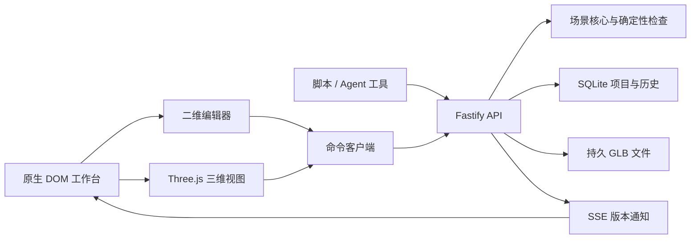
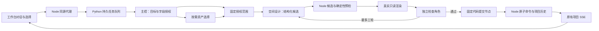

# 模块、来源与迁移边界

`packages/scene-core/src/index.ts` 是浏览器和服务共享的类型化场景入口；类型定义在 `types.ts`。`inherited/` 保存按语法绑定提取的原版目录、结构计算、占地算法和 HouseSpec 转换。核心没有 DOM、window、localStorage 或 IndexedDB 依赖。

`apps/service/src/store.ts` 负责版本、请求身份、原子状态与 200 个事务的历史位置。`assets.ts` 验证自包含 GLB，按实际顶点计算尺寸并记录原版单位启发式、底部与中心归一化。实例变换与文件元数据分开保存。

`apps/editor/src/views/` 分别负责二维交互和三维生命周期。`ui/inspector.ts` 负责配方属性。建模模块 `modeling/` 中的原版几何和二维图形函数保留，输入是普通项目对象；新工作台不加载原 HTML 或旧全局应用。

每个视图保存其实际显示快照的项目身份与修订号。拖动、轮廓编辑和属性控件使用这一上下文提交；交互中收到 SSE 更新也不会把旧操作自动改成新版本。版本过期时服务拒绝提交，界面恢复最新场景，避免覆盖脚本或另一页面的修改。

原版 `commit()` 的墙体重算、房间识别与标签恢复在 `normalizeState()` 中贯通。原隐藏标签档案 `ol` 改为显式 `roomLabelArchive` 参数，并随当前场景和历史持久化。显示缓存、三维网格、GLB 内存缓存不作为正式状态存储，重开时从配方与文件重建。

## 从打包 HTML 提取

`scripts/analyze-upstream.mjs` 使用 Babel 建立顶层绑定及其依赖；`scripts/extract-upstream.mjs` 按真实作用域提取依赖闭包，保留家具目录初始化的独立副作用。不是通过全局字符串替换压缩变量名来拆包。

Three.js 核心类映射到 npm `three@0.160.0`。原版定制几何辅助函数继续保留，与其参数化行为一起对照验证。继承模块里的短符号名保留来源定位，产品代码通过有语义的 TypeScript 入口调用；主要映射：

| 上游符号          | 新模块用途                       |
| ----------------- | -------------------------------- |
| Hc / q0 / yu      | 家具实例、完整目录、分组         |
| Wc / D4 / nM      | 墙几何、房间区域、标签恢复       |
| Gb / xd           | HouseSpec 导入、空项目           |
| Zg / Ts           | 占地分解、SAT 相交               |
| Fh / Ov           | 完整二维家具绘制、三维参数化几何 |
| Ns / yi / Pt      | 橱柜参数归一化、分段、部件       |
| Ko / Qu / Sv / qC | 地面、墙面与自定义铺砖           |

提取清单 `extraction-manifest.json` 记录模块、绑定与依赖。`npm run test:reference` 验证原版十个文件哈希、无残余 Three 核心捆绑块、核心不依赖浏览器。重新提取后应执行建模对照，不能仅以构建成功判定保真。

## 明确差异

- 项目从 localStorage/IndexedDB 迁至服务；GLB 文件与撤销历史跨浏览器 / 服务重启持久恢复。
- 原版只有本次页面会话内撤销；新版保存完整历史 cursor，并保留撤销后分支审计记录。
- 原版普通 JSON 不包含模型字节，新版也使用引用，但附资产清单且提供明确的缺失映射流程。
- 普通三维模式使用原版的小圆角参数（max 0.012m / k 0.18）。体素式 / 彩色平面风格对应参数也保留。完整灯光、后处理和相机工作台由新视图管理，截图不承诺逐像素相同。
- 多楼层、光追、全景、高级日照、水电、报价、施工图与智能家居演示不提供入口。原目录中的楼梯、电梯、空调等家具仍保留。上游隐藏的空调送风演示网格不是家具实体，目录尺寸对照排除这些隐藏辅助网格。
- 当前结构渲染采用墙段 / 洞口 / 边框表达，门窗扇型装饰和原版高级交互动画没有逐像素复刻。保存的门窗类型、宽度、高度、门轴与方向不会丢失。
- 外部 GLB 在二维中使用实例包围矩形，实际网格与贴图在三维中显示；检查工具也明确采用矩形占地。
- 原版 GLB 的 `color` 是二维表示色，不参与原文件的三维着色。新版保留这个约定，用独立 `opt.tint` 记录用户显式叠加色，避免导入旧项目时改变材质；材质恢复与撤销已纳入浏览器检查。
- 新校验拒绝宽度不大于 400 mm 的庭院门配方，避免原版固定立柱宽度导致的负圆弧半径；这个行为修复与原版模块提取分别提交。
- 自由模型透明度遵循材质默认值或显式 `opt.op`（0–1），属性框显示实际生效值。风格控件沿用原版适用家具类型，目录 API 同时公开这些约束和默认值。

## S2-A 编排与提交边界

`apps/agent/actiscape_agent/workflow.py` 使用 LangGraph 管理角色、分支、修复和一次版本重规划；`manager.py` 管理持久队列和 SQLite 检查点。四角色在 `roles.py` 中分别创建 LangChain Agent 和上下文；提示词与工具范围分开。角色模型共享 DeepSeek 官方服务，但不共享一段无边界的会话上下文。

正式场景数据库只由 Node 写入。`candidate.ts` 生成稳定命令并验证 scope，`candidates.ts` 绑定快照、哈希、图片、独立检查及固定 operationId。Agent 不获得任意 HTTP、脚本或正式场景写工具；最终提交由固定流程节点执行，并在 Node 重新检查后进入原有事务。一次自动应用仍对应一个可撤销事务。

`apps/editor/src/render.ts` 是只读候选显示入口，使用同一三维渲染和有效离地计算；取证时墙体透明、吊顶隐藏，固定俯视和斜视。图片不是用户界面截图的替身，项目业务字段检查和真实工作台操作分别验收。

任务的 requestId、预算、焦点对象和事件保存在独立 `tasks.sqlite`；LangGraph 父流程检查点在 `checkpoints.sqlite`。提交结果不明时只重试原候选与操作身份，不创建第二份正式修改。角色节点中断可以重跑只读工具或预检，提交幂等由正式项目服务保证。

## S2-B 矩形生成

新任务模式 `generate_rectangular` 从空白项目启动，主控输出带用户原文依据的结构化需求。`generation_schemas.py` 保留原始单位并检查缺失项；`rectangular.ts` 统一换算净尺寸、编译 HouseSpec、固定结构身份并返回只读预览。几何计算仍由共享 TypeScript 核心承担。

初始化候选单独声明 `kind=initialize`，只接受固定矩形结构上的目录家具新增。提交前重新编译结构、比较快照，并复用原子命令与历史。新旧候选分别验证，旧候选 JSON 和哈希不重写。门前局部净空检查参与基准比较；初始生成不能靠缩小默认家具来通过检查。

`GenerationRoles` 使用独立提示词，复用现有 LangChain 调用、预算和四角色名称。资产结果动态校验每项请求对应一个配方及完整零基索引；结构化错误通过真实框架工具反馈校正，重试继续计入预算。主控、资产、设计与检查均不获得正式提交工具。

首个文件 Skill 包有 manifest、正文及许可。加载器检查所需工具，向设计和检查角色传入正文，任务保存完整快照、版本和内容哈希。Skill 不是任意脚本执行入口；正式 Skill 池与外层优化仍归后续阶段。

工作台的新建流程进入生成对话；摘要卡显示关键尺寸、门窗、家具、缺失项和默认值。生成成功后继续编辑，任务与会话共用现有恢复机制。Node 数据库迁移版本为 2，Agent 为 1，项目导出格式仍为 1。

当前已实现矩形文字初始生成、首个真实设计 Skill、自然语言局部家具编辑、四角色协作与本机恢复。户型图解析、照片生成、正式 Skill 池、GEPA 与 AgentArts 完整部署仍为后续工作。平台包仅完成本机 SDK 的最小真实工具通道验证。
