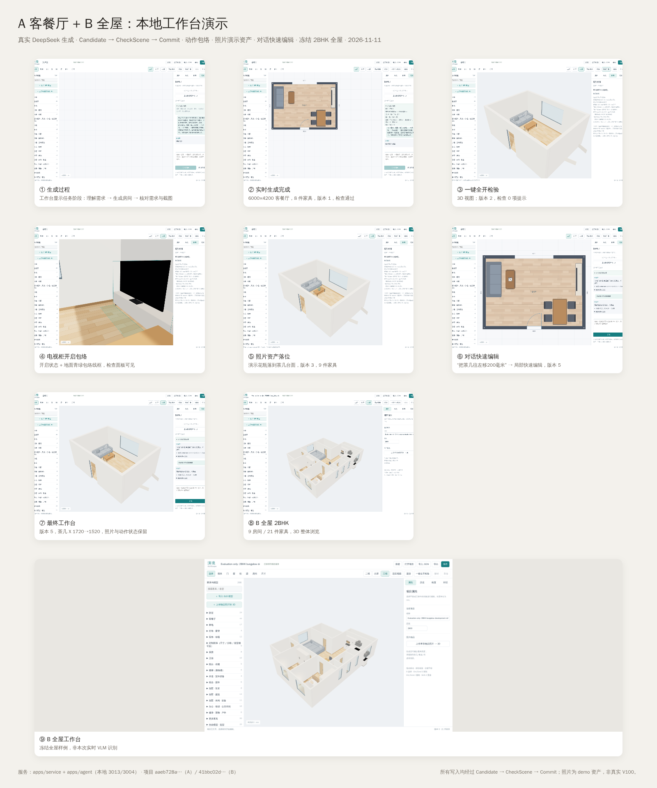

# A 客餐厅 + B 全屋：本地工作台演示记录（2026-11-11）

> 本次演示在本地 `apps/service` + `apps/agent` 上运行；所有场景写入均经过 **Candidate → CheckScene → Commit**。  
> 不是真实 V100，也不是真实华为云 AgentArts 部署。

## 1. 演示结论

- A：DeepSeek 实时生成 6000×4200 客餐厅，8 件家具，检查通过；
- 一键全开检验、电视柜开启包络、照片花瓶落位、对话“把茶几往左移 200 毫米”均完成；
- B：打开冻结的 2BHK 全屋样例，9 房间 / 21 件家具，3D 整体浏览；
- 最终 A 项目 revision 5，9 件家具；B 项目 revision 0，21 件家具。



## 2. A 场景输入

```text
请从空白生成一个矩形客餐厅，室内横向净宽6000毫米、纵向净深4200毫米。
入口在南墙居中；窗在北墙居中，窗宽2400毫米。
需要一张三人沙发、一个茶几、一个电视柜、一张餐桌和四把餐椅。
使用简约中性配色，家具采用目录默认尺寸，门窗宽高和层高使用系统默认值。
```

## 3. 工作台交互过程

| 步骤 | 操作 | 结果 |
| --- | --- | --- |
| 1 | 新建空白项目，在对话中发送上面的生成需求 | 工作台显示任务阶段：理解需求 → 生成房间 → 核对需求与截图 |
| 2 | 等待任务完成 | revision 0→1，8 件家具，检查通过 |
| 3 | 切到 3D，点击“一键全开检验” | revision 1→2，门/柜门/抽屉全部打开 |
| 4 | 选中电视柜，查看检查面板 | 电视柜开启包络以青绿半透明区域显示；检查 0 项提示 |
| 5 | 点击“上传物品照片转 3D”，上传演示花瓶，确认高度 280mm、宿主茶几 | revision 2→3，台面落位，9 件家具 |
| 6 | 对话输入“把茶几往左移200毫米”（首次命中选中花瓶，修复目标优先级后重跑） | 最终 revision 5，茶几 X 1720→1520，局部快速编辑完成 |
| 7 | 打开冻结 2BHK 项目 | 9 房间 / 21 件家具，3D 整体浏览 |

### 工作台是否实时显示“构建过程”

- 会显示**任务阶段、状态、检查结果、证据图、revision**；
- 不会在模型生成时逐帧把家具“长”进 3D；
- 3D 正式场景在 Candidate 通过 CheckScene 并 Commit 后刷新；
- 这是 Candidate 门禁的刻意设计，不是进度丢失。

## 4. 关键截图

- [生成过程](evidence/demo-ab-20261110/a1-generating.png)
- [生成完成（2D）](evidence/demo-ab-20261110/a2-generated.png)
- [一键全开（3D）](evidence/demo-ab-20261110/a3-open-all.png)
- [电视柜开启包络](evidence/demo-ab-20261110/a13b-tv-open-envelope.png)
- [照片资产落位](evidence/demo-ab-20261110/a6-photo-placed.png)
- [对话快速编辑](evidence/demo-ab-20261110/a11-fast-fixed-chat.png)
- [最终工作台](evidence/demo-ab-20261110/a14-final-workbench-chat.png)
- [B 全屋 3D](evidence/demo-ab-20261110/b1-whole-home-3d.png)
- [B 全屋工作台](evidence/demo-ab-20261110/b2-whole-home-full.png)

## 5. 本轮发现并修复的问题

演示过程中发现并修复了两个真实交互问题：

1. **本地代理误删 `/conversations` 的 `projectId`**
   - 之前 `localBody` 对所有请求剥离 `projectId`，导致 `POST /agent/conversations` 422；
   - 现在只对 task create / resume 剥离，`/conversations` 保留；
   - 新增本地代理测试。
2. **快速编辑目标优先级**
   - 之前选中花瓶后说“把茶几往左移”会移动被选中的花瓶；
   - 现在显式家具名称优先于当前选择；只有“它/这把”才回退到选择；
   - 快速编辑完成消息也改为“局部快速编辑已提交”。
3. **撤销卡顿**
   - `undo/redo/commands` 的响应本身包含完整项目；
   - 前端直接用响应刷新，不再额外发一次 GET，减少一个网络往返；
   - 本地实测撤销约 850ms，重做约 1.5s（含 3D 重建）。
4. **漫游按钮无反应**
   - `setView("3d")` 下一帧会调用 `three.frame()`，把漫游相机重置回全景；
   - 现在“漫游”进入时不执行普通取景，漫游相机不会被覆盖；
   - 实测 `walking=true`，WASD 可移动；截图：[walk-mode.png](evidence/demo-ab-20261110/walk-mode.png)。

## 5.1 体验反馈后的交互修正（2026-11-11）

- 顶部默认只保留“选择”；墙体、门窗、柱梁、房间、尺寸收进“结构工具”，不再一屏铺满；
- 非空白项目隐藏“上传户型图”，避免无效按钮；
- 选中电视柜/衣柜等可开启家具时，视口左上角出现“已选：电视柜 / 打开柜门（关闭柜门）”操作条，不再只能猜 E 键；
- 顶部新增“可开启家具”定位下拉框，选择后自动切到 3D、聚焦对象并选中；
- E 键无选中或对象不可开启时给出明确提示，而不是静默；
- 漫游按钮进入后变为“退出漫游”，Esc 退出后恢复；
- 撤销改用 mutation 响应直接刷新，去掉多余的 GET；
- 修复漫游进入时普通取景覆盖相机的问题。

截图：[ux-tv-action.png](evidence/demo-ab-20261110/ux-tv-action.png)

## 6. 边界

- A 使用真实 DeepSeek 生成；B 使用冻结 2BHK fixture，不是实时 VLM；
- 照片资产是 demo provider 的固定花瓶，不是真实 V100 产物；
- 没有真实华为云 AgentArts 部署；
- 工作台没有逐帧 3D 施工动画；当前是任务进度 + 提交后刷新；
- 2D 绘图中的照片用占位图标表示，3D/属性面板显示实际模型。

## 7. 复现

服务：

```bash
ACTISCAPE_DATA_DIR=/tmp/p0-live-data PORT=3013 ACTISCAPE_AGENT_URL=http://127.0.0.1:3004 npm start
AGENT_PORT=3004 ACTISCAPE_SCENE_URL=http://127.0.0.1:3013 ACTISCAPE_AGENT_DATA_DIR=/tmp/demo-agent .venv/bin/python -m actiscape_agent
```

打开：

```text
http://127.0.0.1:3013/?project=aaeb728a-7661-434f-bf4c-fa074ad768c0
```

B：

```text
http://127.0.0.1:3013/?project=41bbc02d-c4e1-49a8-a2e5-4cae4b112170
```
