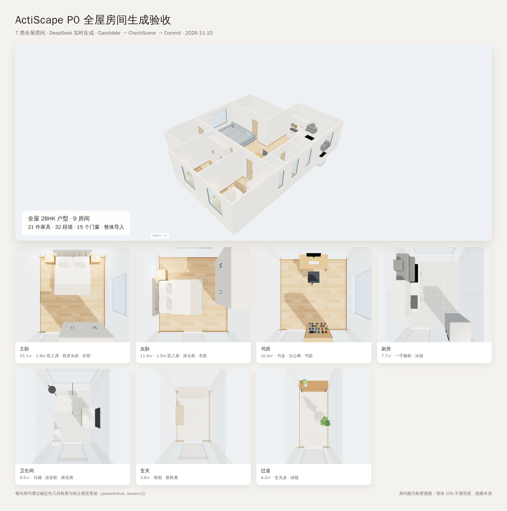

# P0 全屋多房间阶段验收（2026-11-10）

> 验收口径：用户只看最终可展示成果；代码、契约与设计由执行 Agent 自验收。
> 本文件记录自验收结论、真实运行证据与仍需在后续阶段处理的边界。

## 1. 结论

**P0 的阶段方向合理，但“只解锁注册表 + 补契约”本身不足以验收。**
本次按“能在真实服务里生成并提交、能看见全屋房间”的标准重新验收后，发现并修复了 3 个阻断缺陷；修复后：

- **7 类全屋房间**（主卧、次卧、书房、厨房、卫生间、玄关、过道）均由 DeepSeek 实时生成，经 `Candidate → CheckScene → Commit` 一次提交成功；
- 每间房 `checks.passed=true`、独立视觉复核 `review.passed=true`，家具数量与用户要求一致；
- **全屋 2BHK 示例**（9 房间、21 件家具、32 段墙、15 个门窗）可在 3D 编辑器中整体查看；
- Node 63 项、Python 153 项、`npm run build` 全部通过。

## 2. 最终展示



- 大图：全屋 2BHK 的 3D 视图（9 房间 / 21 件家具）。
- 下方：7 类房间的检查视图（墙体 15% 不透明度、隐藏吊顶），每间房标注面积与家具清单。

单独图片与机器可读结果：

- [全屋 3D 画布](evidence/p0-whole-home-20261110/whole-home-2bhk-canvas.png)
- [验收结果 JSON](evidence/p0-whole-home-20261110/acceptance.json)
- 每间房 `*-top.png`（俯视布局）与 `*-oblique.png`（斜视净空）

### 实时生成结果

| 房间 | 面积 | 生成家具 | 模型调用 | 检查 | 复核 |
| --- | ---: | --- | ---: | --- | --- |
| 主卧 | 15.1㎡ | 1.8m 双人床、双床头柜、衣柜 | 9 | 通过 | 通过 |
| 次卧 | 11.9㎡ | 1.5m 双人床、床头柜、衣柜 | 10 | 通过 | 通过 |
| 书房 | 10.9㎡ | 书桌、办公椅、书架 | 9 | 通过 | 通过 |
| 厨房 | 7.7㎡ | 一字橱柜、冰箱 | 10 | 通过 | 通过 |
| 卫生间 | 4.5㎡ | 马桶、浴室柜、淋浴房 | 12 | 通过 | 通过 |
| 玄关 | 3.8㎡ | 鞋柜、换鞋凳 | 9 | 通过 | 通过 |
| 过道 | 4.2㎡ | 玄关桌、绿植 | 9 | 通过 | 通过 |

每间房均为 `revision 1` 的单事务提交，可撤销；草稿/候选阶段未写入正式项目。

## 3. 自验收发现的阻断缺陷（均已修复）

### 3.1 `Candidate` 与 `precheck` 复用同一 scene-draft requestId

- **现象**：主卧真实生成在 `prechecking` 阶段失败：`相同 requestId 对应不同草稿 patch`。
- **根因**：Design Agent 先调用 `precheck_initialization`（生成候选 A），再返回最终候选 B；`GenerationRoles.candidate()` 用 `candidate-{round}` 作为 scene-draft patch 的 requestId，A/B 轮次相同但内容不同。
- **修复**：patch requestId 改为绑定真实 `candidate.id`（`generation_roles.py`），并增加回归测试 `test_scene_patch_identity_is_candidate_bound_not_round_bound`。

### 3.2 小面积厨卫/玄关选不到 `style-coherence` / `lighting-color`

- **现象**：厨房、卫生间、玄关在 `SkillSelection` 阶段直接失败：modifier 不在候选短名单。
- **根因**：两个 modifier 的 `appliesTo.areaM2` 下限为 8㎡，小房间候选为空；模型仍按习惯选择了它们，严格校验随即拒绝。
- **修复**：将两个 modifier 的面积下限调整为 1㎡（风格与照明建议同样适用于厨卫/玄关/过道），并增加小房间 modifier 候选测试。

### 3.3 门位置 evidence 被省略号改写导致误判“缺少入口”

- **现象**：次卧第一次生成返回 `waiting_input：请补充或确认入口墙面与位置`，但用户原话已明确“入口在南墙居中”。
- **根因**：模型把 evidence 写成带省略号的拼接句，`resolve_request` 的逐字子串校验不通过，于是丢弃了合法门信息。
- **修复**：BRIEF_PROMPT 明确要求 evidence 为连续逐字原话、不得省略/改写/拼接。

### 3.4 窗帘占用门洞净空被误报

- **现象**：次卧正例在门洞 800mm 检查中因落地窗帘报 `DOORWAY_BLOCKED`。
- **修复**：门洞净空检查豁免窗帘、纱帘、地毯（它们已有 `CUR-01` 专项检查），并增加回归测试。

## 4. 验收命令

```bash
npm test                      # 63 passed / 0 failed
npm run build                 # typecheck + vite build 通过
PYTHONPATH=apps/agent .venv/bin/python -m pytest apps/agent/tests -q   # 153 passed
npm run test:all              # EXIT 0（baseline / extended / browser / parity / catalog / visual）
```

真实生成使用隔离服务（`PORT=3013` + agent `3004`），未写入仓库 `data/` 正式库。

## 5. 已知边界（不阻塞 P0 验收，进入 P1/P3 处理）

1. **确定性排布兜底尚未实现**：当前 7 类房间依赖 DeepSeek 实时设计；卫生间单次约 12 次模型调用、耗时数分钟。计划中的 `roles.py` 确定性排布仍应在 P1/P3 补齐，作为模型失败/超时的保底。
2. **新激活 Skill 的 L3 回放覆盖仍为 7 个**：`scripts/skill-pool-v1-replay.mjs` 的 active 列表未纳入新增 6 个；部分边界示例（如 `GBR-dev-02`）与当前 `WIN-01/DOORWAY_BLOCKED` 输出存在预期冲突，需在判据/示例治理时统一。
3. **全屋 2BHK 展示使用冻结参考 fixture**：本次未启动本地 VLM，因此全屋图由 `fixtures/full-home-candidates/2bhk-bungalow.evaluation-only.json` 经 `materializeFloorplan` 落成，用于验证“9 房间 + 21 家具”的渲染与整体浏览；V4 实时识图链路由 Node/Python 回归覆盖，未做本次真人 VLM 复核。
4. **文字生成仍是单任务单矩形房间**：全屋多房间由户型图入口完成；一次文字生成多房间属于后续扩展。

## 6. 关键改动文件

- 房间与 Skill 数据：[scene-registry.v1.json](../apps/agent/actiscape_agent/scene-registry.v1.json)、[skills/index.v1.json](../apps/agent/actiscape_agent/skills/index.v1.json)
- 生成链：[generation_roles.py](../apps/agent/actiscape_agent/generation_roles.py)、[generation_schemas.py](../apps/agent/actiscape_agent/generation_schemas.py)、[generation_flow.py](../apps/agent/actiscape_agent/generation_flow.py)、[floorplan_v3.py](../apps/agent/actiscape_agent/floorplan_v3.py)
- 场景契约：[room-kinds.ts](../packages/scene-core/src/room-kinds.ts)、[floorplan.ts](../packages/scene-core/src/floorplan.ts)、[floorplan-scene-draft.ts](../packages/scene-core/src/floorplan-scene-draft.ts)、[scene-program.ts](../packages/scene-core/src/scene-program.ts)、[scene-contracts.ts](../packages/scene-core/src/scene-contracts.ts)、[rectangular.ts](../packages/scene-core/src/rectangular.ts)
- 编辑器：[ui/floorplan.ts](../apps/editor/src/ui/floorplan.ts)
- 回归：`tests/floorplan-v4.test.ts`、`tests/core.test.ts`、`apps/agent/tests/test_generation_workflow.py`、`test_scene_contracts.py`、`test_skill_registry_v1.py`、`test_floorplan_v4.py`
