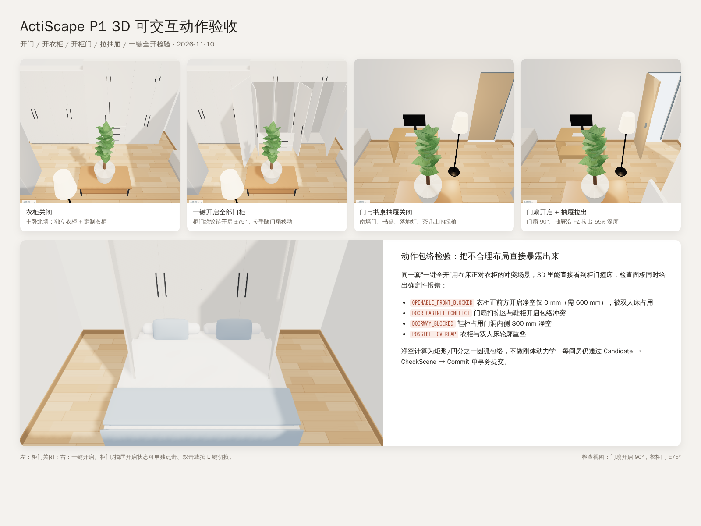

# P1 3D 可交互动作阶段验收（2026-11-10）

> 验收口径：用户只看最终可展示成果；代码、契约与设计由执行 Agent 自验收。
> 本阶段对应 `1110计划.md` 第 6 部分的 P0 内容（用户编号 P1）。

## 1. 结论

P1 已完成并通过自验收：**开门/关门、开衣柜/柜门、拉抽屉、一键全开检验、动作包络净空检测、台面吸附**均已落到真实编辑器与确定性几何内核中。

- 干净主卧场景：8 件家具、0 项检查问题；“一键全开”同时打开 5 件柜体/抽屉与 1 扇门，再点一次复位。
- 冲突场景：床正对衣柜 + 鞋柜挡门，3D 中直接看到柜门撞床；检查面板给出 `OPENABLE_FRONT_BLOCKED`、`DOOR_CABINET_CONFLICT`、`DOORWAY_BLOCKED`。
- 交互验证：双击、选中后按 `E`、第一人称漫游中对准柜体按 `E`、Inspector 复选框、工具栏“一键全开检验/复位门柜”均可用。
- Node 69 项、Python 153 项、构建与全量验收通过。

## 2. 最终展示

- 左上/右上：衣柜关闭 → 一键开启，柜门绕铰链 ±75°。
- 左下/右下：南墙门 + 书桌抽屉关闭 → 门扇 90°、抽屉拉出 55%。
- 底部：床正对衣柜的冲突场景，柜门开启直接撞床；检查面板同时给出确定性错误码。

补充证据：

- [检查面板完整截图（4 项问题）](evidence/p1-actions-20261110/32-conflict-checks.png)
- [一键开启后的全屋俯视](evidence/p1-actions-20261110/44-overview-open.png)
- [机器可读验收 JSON](evidence/p1-actions-20261110/acceptance.json)

## 3. 实现内容

### 3.1 `packages/scene-core`

- 新增 [`actions.ts`](../packages/scene-core/src/actions.ts)：
  - `OpenableSpec` / `openableSpec()`：衣柜 600 mm、推拉衣柜 500 mm、其余柜体/抽屉 450 mm。
  - `openEnvelope()`：按 `rot` 生成柜门/抽屉正前方开启矩形包络；`rot=90/270` 正确处理宽深互换。
  - `surfaceHostFor()`、`surfaceElevation()`、`surfaceOverhang()`、`resolveSurfacePlacement()`：台面宿主与 `z = host.z + host.h`。
  - `SceneActionState`、`sceneActionState()`：门/柜/电器的可序列化动作状态。
  - `toggleActionCommand()`：门、柜门、抽屉、灯/电视/窗帘的统一切换命令。
  - `allDoorCabinetCommands()`：一键全开/复位命令。
- [`checkScene()`](../packages/scene-core/src/index.ts) 新增：
  - `OPENABLE_FRONT_BLOCKED`：柜门/抽屉开启包络撞墙或被家具占用，报剩余净空 mm。
  - `DOOR_CABINET_CONFLICT`：门扇四分之一圆弧扫掠区与柜门包络相交。
  - `SURFACE_ITEM_OVERHANG` / `SURFACE_ITEM_COLLISION` / `SURFACE_ITEM_HOST_MISSING`：台面越界、同台面碰撞、宿主缺失。
  - 台面物品按有效高程参与碰撞；父子支撑关系不再误报 `POSSIBLE_OVERLAP`。
- [`types.ts`](../packages/scene-core/src/types.ts)：家具新增 `placement`、`parentObjectId`，并在 `validatePlan` 中校验。
- [`placement.ts`](../packages/scene-core/src/placement.ts)：`furnitureElevation()` 支持父级台面链式高程。

### 3.2 `apps/editor`

- [`furniture-3d.js`](../apps/editor/src/modeling/furniture-3d.js)：
  - `TD/_D` 柜门的门扇 + 拉手绕真实铰链旋转 ±75°；
  - 抽屉沿柜体正前方拉出 55% 深度；
  - 推拉衣柜门扇横向错位；
  - 独立衣柜、电视柜、鞋柜、床头柜、书桌、冰箱在 `opt.open` 时增加轻量开启姿态。
- [`three-view.ts`](../apps/editor/src/views/three-view.ts)：
  - 双击柜门/抽屉/门扇切换；
  - 选中后按 `E` 切换；
  - 第一人称漫游中射线命中前方 ≤2.5 m 物体按 `E` 切换；
  - 手动双击检测（350 ms / 12 px）避免 pointer capture 吞掉原生 `dblclick`。
- [`inspector.ts`](../apps/editor/src/ui/inspector.ts)：可开启家具新增“打开柜门/拉出抽屉（检验开启净空）”复选框。
- [`main.ts`](../apps/editor/src/main.ts)：工具栏“一键全开检验 / 复位门柜”，提交后自动切到“检查”面板。

## 4. 验证记录

| 验证项 | 结果 |
| --- | --- |
| 一键全开（干净场景） | revision 0 → 1，5 件柜体/抽屉 + 1 扇门打开 |
| 一键复位 | revision 1 → 2，全部关闭，按钮文案切回“一键全开检验” |
| 选中 + `E` | 衣柜 open true → false，revision +1 |
| Inspector 复选框 | 重新打开，revision +1 |
| 3D 双击 | 衣柜 open false → true，revision +1 |
| 漫游 `E` | 前方衣柜打开，revision +1 |
| 冲突场景 | 4 项确定性报错，3D 中柜门与床穿插可见 |
| 干净场景检查 | `issues=[]` |
| `npm test` | 69 passed / 0 failed |
| `pytest apps/agent/tests` | 153 passed |
| `npm run build` | typecheck + vite 通过 |
| `npm run test:all` | 通过（baseline / browser / parity / catalog / visual） |

## 5. 已知边界

1. **不是刚体物理**：开启包络是矩形与四分之一圆弧近似，不做门扇动力学、重力或地震；符合计划“暂缓 Cannon.js/Rapier”的红线。
2. **独立家具的开启姿态是轻量 overlay**：衣柜/冰箱等没有真实五金分层，只看开关状态与包络；TD 定制柜的门扇/抽屉是真实网格变换。
3. **推拉门是横向错位**：未实现完整滑轨/门腔结构。
4. **台面吸附已支持目录物品与显式 `parentObjectId`/`placement: "surface"`**；照片转 3D 资产的实际接入在 P2。

## 6. 关键改动文件

- [`actions.ts`](../packages/scene-core/src/actions.ts)
- [`index.ts`](../packages/scene-core/src/index.ts)（checkScene 新判据）
- [`types.ts`](../packages/scene-core/src/types.ts)、[`placement.ts`](../packages/scene-core/src/placement.ts)
- [`furniture-3d.js`](../apps/editor/src/modeling/furniture-3d.js)
- [`three-view.ts`](../apps/editor/src/views/three-view.ts)
- [`inspector.ts`](../apps/editor/src/ui/inspector.ts)、[`main.ts`](../apps/editor/src/main.ts)
- [`tests/actions.test.ts`](../tests/actions.test.ts)、[`tests/core.test.ts`](../tests/core.test.ts)

## 7. 下一步

进入 **P2：照片转 3D 资产入场**：
- `apps/service` 三级资产提供器（真实 V100 缓存 → 远端 GPU 异步 → Demo fallback）；
- `/api/assets/generate-from-image`、`/api/assets/:id/calibrate`；
- `photo-object-import` Skill 激活；
- 上传单张照片 → 预览/校准 → 台面吸附放置到茶几/书桌/地面，复用本阶段 `resolveSurfacePlacement()`。
