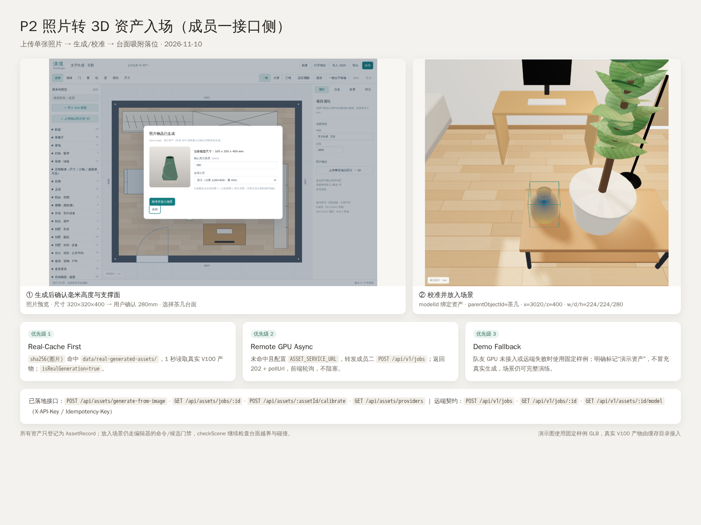

# P2 照片转 3D 资产入场阶段验收（2026-11-10）

> 前提：成员二的 Hunyuan3D-2 / V100 服务仍在开发中。本阶段只完成**成员一负责的接口、
> 三级资产提供器、缓存契约、编辑器闭环与 Skill 激活**；真实 V100 产物接入后无需改前端契约。
>
> 验收口径：用户只看最终可展示成果；代码、契约与设计由执行 Agent 自验收。

## 1. 结论

P2 成员一侧已完成并通过自验收：

- `apps/service` 已实现 **Real-Cache First → Remote GPU Async → Demo Fallback** 三级资产提供器；
- 已提供 `POST /api/assets/generate-from-image`、`GET /api/assets/jobs/:id`、
  `POST /api/assets/:assetId/calibrate`、`GET /api/assets/providers` 等接口；
- 编辑器工作台、对话面板、属性面板三处入口均可用；
- 上传照片 → 生成/排队 → 确认毫米高度 → 吸附到茶几台面 → 单事务写入项目，闭环已跑通；
- `photo-object-import` Skill 已升级为 `verified + active`，并在 `SkillRegistry` 中注册
  `asset_import` 模式。

## 2. 最终展示



- 左：上传照片后确认高度 280 mm、选择茶几台面；界面明确标注“演示资产”，不冒充真实 V100。
- 右：模型放入场景后 `parentObjectId=茶几`、`z=400 mm`、`w/d/h=224/224/280`；
  属性面板显示“支撑关系：台面宿主：茶几 · 底面高程 400 mm”。

补充证据：

- [生成/校准对话框](evidence/p2-photo-assets-20261110/70-dialog.png)
- [台面落位 3D](evidence/p2-photo-assets-20261110/71-placed.png)
- [机器可读验收 JSON](evidence/p2-photo-assets-20261110/acceptance.json)

## 3. 三级资产提供器

| 优先级 | provider | 触发条件 | 行为 |
| --- | --- | --- | --- |
| 1 | `real-cache` | 图片 `sha256` 命中 `data/real-generated-assets/<sha>/` | 1 秒读真实 V100 产物；`isRealGeneration=true` |
| 2 | `remote-gpu` | 未命中且配置 `ASSET_SERVICE_URL` | 异步转发成员二 `POST /api/v1/jobs`，立即返回 202 + pollUrl |
| 3 | `demo` | 未配置 GPU 或远端失败 | 固定样例 GLB，明确标记演示；远端失败保留 `remoteError` |

- 远端成功后自动下载 GLB、登记资产并写入真实缓存目录，下一张同图直接命中缓存。
- 网关兼容成员二 `result.model_url` 绝对 URL 与 `/api/v1/...` 相对路径。
- 请求头支持 `X-API-Key`、`Idempotency-Key`（图片 sha256）。

接口与环境变量完整说明见 [`docs/ASSET_PROVIDER.md`](ASSET_PROVIDER.md)。

## 4. 缓存契约

```text
data/real-generated-assets/<input_sha256>/
  input.png
  asset.glb
  metadata.json
```

`metadata.json` 包含 `input_sha256`、`name`、`category`、`is_real_generation`、`size_mm`、
`glb_sha256`、`scale_calibrated`、`scale_source`、`created_at`。
当前仓库缓存案例为 **0**（等待成员二 V100 产物）；目录契约与加载逻辑已通过临时缓存测试。

## 5. 编辑器闭环

1. 工作台“上传物品照片转 3D”、对话面板按钮、属性面板入口三处均可发起；
2. 前端上传图片，显示“真实缓存 / 远端 GPU / 演示资产”来源；
3. 远端任务返回 `pollUrl`，前端每 2 秒轮询，不阻塞对话或工作台；
4. 用户确认真实高度（如 280 mm），调用 `POST /api/assets/:assetId/calibrate`；
5. 用户选择茶几/餐桌/书桌/电视柜/床头柜台面或地面；
6. 生成普通 `furniture` 命令：
   - 台面：`placement="surface"`、`parentObjectId=<host.id>`、`z=host.z+host.h`；
   - 地面：`placement="floor"`、`z=0`；
7. 仍走编辑器 `commands` 事务；`checkScene` 的 `SURFACE_ITEM_OVERHANG` /
   `SURFACE_ITEM_COLLISION` 负责最终校验。

## 6. 验证记录

| 验证项 | 结果 |
| --- | --- |
| Demo fallback + 校准 | 通过：400 → 280 mm，w/d 等比 224 mm，`scaleCalibrated=true` |
| Real-Cache 命中 | 通过：临时缓存目录 1 秒命中，`provider=real-cache`，`cached=true` |
| Remote GPU 异步 | 通过：假 FastAPI 兼容服务返回 202 → 轮询 running → succeeded → 下载 GLB → 写缓存 |
| 远端不可达回退 | 通过：`provider=demo`、`fallback=true`、保留 `remoteError` |
| 编辑器放置 | 通过：`revision 1`，`parentObjectId=茶几`，`z=400`，`h=280` |
| 三处入口 | 通过：library / chat / inspector 均存在 |
| `npm test` | 73 passed / 0 failed |
| `pytest apps/agent/tests` | 154 passed |
| `npm run build` | typecheck + vite 通过 |
| `npm run test:all` | 通过（baseline / browser / parity / catalog / visual） |

## 7. 尚未完成（依赖成员二或 P3）

1. **真实 V100 产物尚未入缓存**：等成员二把减面/校准后的 `asset.glb` 放入
   `data/real-generated-assets/<input_sha256>/`，网关会自动切换到 `real-cache`。
2. **成员二独立 `/calibrate`**：其分支当前还没有该接口；网关已先提供稳定的本地
   `/api/assets/:assetId/calibrate`，后续可透明透传。
3. **Agent `photo_to_scene` Policy 路由**：按计划属于 P3（`PolicyController` +
   `SkillDispatcher`）；本阶段完成的是网关、Skill 注册和编辑器闭环。
4. **演示 GLB 与上传图不一致**：Demo 固定样例是一只盆栽/花瓶，仅用于验证闭环；
   真实 GPU 接入后由缓存/远端产物替换。

## 8. 关键改动文件

- [`asset-provider.ts`](../apps/service/src/asset-provider.ts)：三级提供器、异步任务、缓存、校准。
- [`apps/service/src/app.ts`](../apps/service/src/app.ts)：生成/轮询/校准/providers 路由。
- [`apps/service/src/assets.ts`](../apps/service/src/assets.ts)：`calibrateAssetRecord`、图片 MIME 校验。
- [`apps/service/src/store.ts`](../apps/service/src/store.ts)：资产记录更新。
- [`packages/scene-core/src/types.ts`](../packages/scene-core/src/types.ts)：`AssetRecord` 来源/校准/放置字段。
- [`apps/editor/src/main.ts`](../apps/editor/src/main.ts)、[`ui/chat.ts`](../apps/editor/src/ui/chat.ts)、[`ui/inspector.ts`](../apps/editor/src/ui/inspector.ts)：上传、预览、校准、台面落位。
- [`skill_registry.py`](../apps/agent/actiscape_agent/skill_registry.py)、`skills/photo-object-import/`：`asset_import` 与 Skill 激活。
- [`tests/asset-provider.test.ts`](../tests/asset-provider.test.ts)：demo / cache / remote / fallback / calibrate 回归。
- [`data/real-generated-assets/README.md`](../data/real-generated-assets/README.md)：真实缓存目录契约。
- [`docs/ASSET_PROVIDER.md`](ASSET_PROVIDER.md)：对外接口与成员二远端契约。

## 9. 下一步

- 成员二交付真实 V100 `asset.glb` 后，只需放入缓存目录，主系统自动命中，无需改前端/接口。
- 主系统继续 **P3：SkillDispatcher 双维切片 + PolicyController 四路径**，把
  `photo_to_scene` 作为 Route 2 接入，完成对话侧“放到茶几上”的自然语言落位。
