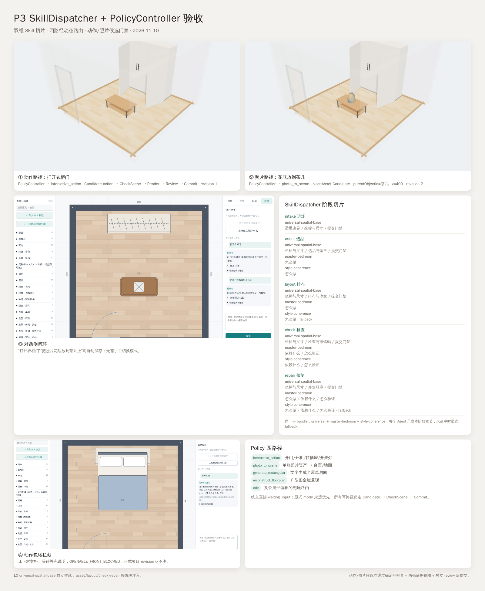

# P3 SkillDispatcher / PolicyController 阶段验收（2026-11-10）

> 验收口径：用户只看最终可展示成果；代码、契约与设计由执行 Agent 自验收。

## 1. 结论

P3 已完成并通过自验收：**Skill 双维阶段切片、L0 通用空间底座、四路径 Policy 动态路由、动作/照片两条确定性候选子流程、RepairPolicyRouter 错误码分流**均已落地。

关键结果：

- 33 个 Skill（+ `universal-spatial-base`），17 active / 16 reserved；
- 每个 Bundle 自动挂载 L0；asset/layout/check/repair 按阶段切片注入，文字生成不再挂 `floorplan-intake`；
- 对话侧“打开衣柜门”自动走 `interactive_action`，一次提交，revision 0 → 1；
- “把照片花瓶放到茶几上”自动走 `photo_to_scene`，placeAsset 候选，`parentObjectId=茶几`、`z=400`，revision 1 → 2；
- 床正对衣柜时“打开衣柜门”返回 `waiting_input` + `OPENABLE_FRONT_BLOCKED`，正式项目 revision 保持 0；
- 动作/照片都不再有绕过 Candidate 的直接写入口。

## 2. 最终展示

- ① 动作路径：衣柜门开启（interactive_action）。
- ② 照片路径：花瓶落到茶几（photo_to_scene）。
- ③ 对话侧两条请求均自动保存，不需要手工切换模式。
- ④ 冲突场景：开门包络被床占用，任务停在 waiting_input，正式项目未改变。
- 右下：policy 四路径与 SkillDispatcher 五阶段切片摘要。

补充证据：

- [对话闭环](evidence/p3-policy-actions-20261110/p3-chat-tasks.png)
- [3D 编辑器中的开启衣柜 + 台面花瓶](evidence/p3-policy-actions-20261110/p3-editor-3d.png)
- [冲突场景对话](evidence/p3-policy-actions-20261110/p3-blocked-chat.png)
- [阶段切片 JSON](evidence/p3-policy-actions-20261110/skill-slices.json)
- [机器可读验收 JSON](evidence/p3-policy-actions-20261110/acceptance.json)

## 3. P3.1：L0 + SkillDispatcher

### 新增 `universal-spatial-base`
- `kind="universal"`、`verified + active`，所有模式自动挂载；
- 章节按阶段可切：`适用边界 / 坐标与尺寸 / 选品与体量 / 排布与净空 / 检查与报错码 / 修复顺序 / 提交门禁 / 进化经验`；
- `priors.json` 提供门洞 800、柜门 450–600、台面容差 20 等结构化先验，作为后续自进化形态 B 的槽位；
- `SkillBundle` 新增 `universal`，`context/public_bundle/records/with_repair` 全链路保留。

### `slice_for_stage(bundle, stage)`
- 支持 `intake / asset / layout / check / repair`；
- 返回 `actiscape.skill-slice.v1`：stage、contentHash、按角色分组的 instructions、judgements；
- universal 按显式章节；房间 Skill 按 `##` 标题 + `**第 N 步**` 子块匹配；
- 未命中时回退全文并标记 `fallback=true`，不静默丢约束；
- 已注入 `GenerationRoles.assets/design/inspect` 与 `Roles.assets/design/inspect`。

### intake 修复
- `GenerationFlow.ground` 的 `include_intake` 改为 `False`；
- 文字生成的 bundle 为 `universal + primary + modifiers`，不再把户型进场文本塞给所有 Agent；
- 相关测试已更新。

## 4. P3.2：Policy + 动作/照片子流程 + Repair

### Candidate 契约扩展
- `CandidateEdit` 新增：
  - `action`：门/家具的 `toggle_open/toggle_on`；
  - `placeAsset`：`assetId` + `placement/parentObjectId/x/y/z`。
- `EditScope` 新增 `actionIds`、`allowedAssets`；
- `materializeEdits` 使用 P1 的 `toggleActionCommand()`，照片尺寸只来自真实 AssetRecord；
- `checkCandidate`：
  - opening 的 `open` 状态不再被当作受保护结构；
  - 动作目标命中 `OPENABLE_FRONT_BLOCKED` / `DOOR_CABINET_CONFLICT` 时升级为 blocking；
  - 照片模型继续走 `SURFACE_ITEM_OVERHANG/COLLISION`。

### `PolicyController`
`apps/agent/actiscape_agent/policy.py` 使用确定性规则，不调用 LLM：

| 路由 | 触发 |
| --- | --- |
| `interactive_action` | 打开/关闭/开灯/电视/窗帘/一键全开 + 明确目标 |
| `photo_to_scene` | 任务携带 `assetId` 或“把照片放到…” |
| `generate_rectangular` | 生成/设计 + 房间词 + 尺寸 |
| `reconstruct_floorplan` | 携带 `imageId` |
| `edit` | 其他局部修改的兜底 |

- 显式 `task.mode` 永远优先；
- 目标不唯一/缺少选中对象直接 `waiting_input`，不猜；
- 路由写入 `task.generation.policy`，并持久化有效 mode；
- 支持普通 `edit` 请求自动升级为动作/照片路由（已由测试覆盖）。

### 两条确定性子流程
- `interactive_flow.py`：动作 Candidate → Render → 确定性 Review → Commit；冲突直接 waiting_input，不改正式项目。
- `photo_flow.py`：解析 `assetId`/`hostId`/选中宿主/文字宿主 → placeAsset Candidate → Render → Commit；`z=host.z+host.h`。
- 两条路径都不调用模型，仍走两张证据视图和独立 review 协议。

### `RepairPolicyRouter`
- `OPENABLE_FRONT_BLOCKED` → design `clear_openable_envelope`
- `DOOR_CABINET_CONFLICT` → design `move_cabinet_out_of_door_swing`
- `SURFACE_ITEM_OVERHANG` → design `rehost_or_floor_surface_item`
- `SURFACE_ITEM_COLLISION` → design `separate_surface_items`
- `DOORWAY_BLOCKED/CIR-02` → design `move_out_of_door_zone`
- `POSSIBLE_OVERLAP/FURNITURE_IN_WALL` → design `separate_objects/pull_from_wall`
- 无安全动作或预算耗尽 → coordinator stop / waiting_input

`Workflow.repair` 对非户型模式统一读取该 directive，Design/Asset Agent 的 payload 增加 `repairDirective`；不再只对 V4-2 生效。

## 5. 真实验收

| 任务 | 结果 |
| --- | --- |
| `interactive_action` 打开衣柜 | completed，revision 0→1，`policy.route=interactive_action` |
| `photo_to_scene` 花瓶到茶几 | completed，revision 1→2，`parentObjectId=茶几`，`z=400` |
| 床正对衣柜再开门 | waiting_input，`OPENABLE_FRONT_BLOCKED`，revision 0 |
| 普通 edit 请求自动升级动作 | completed，policy 自动路由 |
| 普通 edit + assetId 自动升级照片 | completed，policy 自动路由 |
| Node | 76 passed |
| Python | 165 passed |
| `npm run build` | 通过 |
| `npm run test:all` | 通过（baseline / browser / parity / catalog / visual） |

## 6. 已知边界

1. **阶段切片是启发式**：按标题/步骤关键词匹配；未命中会回退全文并标记 `fallback`，不会丢约束但可能携带多余上下文。后续可在 manifest 增加显式 `stageSections` 提升精度。
2. **Repair 只做有界指令**：Router 给出角色、错误码、目标 ID、动作和位移上限；真正的几何移动仍受 Design/Asset 的候选检查与 3 轮预算约束，没有无限自动重排。
3. **动作/照片冲突默认停**：动作或照片候选被包络/台面检查阻断时返回 waiting_input，不擅自移动用户家具。
4. **照片资产仍是 P2 演示样例**：真实 V100 产物接入缓存后自动切换，无需改 P3 路由。
5. **未做 GEPA**：只保留 `priors.json`、`[Evolved Rules]`、可版本化 Skill 包三个槽位。

## 7. 关键文件

- [`universal-spatial-base`](apps/agent/actiscape_agent/skills/universal-spatial-base/)（manifest/SKILL/priors）
- [`skill_registry.py`](apps/agent/actiscape_agent/skill_registry.py)：universal、`slice_for_stage`、bundle/context/records
- [`policy.py`](apps/agent/actiscape_agent/policy.py)：PolicyController、RepairPolicyRouter
- [`interactive_flow.py`](apps/agent/actiscape_agent/interactive_flow.py)、[`photo_flow.py`](apps/agent/actiscape_agent/photo_flow.py)
- [`workflow.py`](apps/agent/actiscape_agent/workflow.py)：policy 节点、动作/照片节点、确定性 inspect、repair 分流
- [`candidate.ts`](packages/scene-core/src/candidate.ts)：action/placeAsset 契约
- [`schemas.py`](apps/agent/actiscape_agent/schemas.py)、[`store.py`](apps/agent/actiscape_agent/store.py)：新 mode 与 assetId/hostId 持久化
- 测试：[`test_policy_controller.py`](apps/agent/tests/test_policy_controller.py)、[`test_action_photo_workflow.py`](apps/agent/tests/test_action_photo_workflow.py)、[`test_skill_registry_v1.py`](apps/agent/tests/test_skill_registry_v1.py)、[`candidate-contracts.test.ts`](tests/candidate-contracts.test.ts)

## 8. 下一步

进入 **P4：华为云 AgentArts 无状态容器化**：
- `POST /api/tools/floorplan-candidate`，让 `floorplan_vision/runner.py` 通过 `ACTISCAPE_SCENE_URL` 远程取视觉候选；
- `deploy/agentarts-minimal/agent.py` 同时支持平台冒烟与完整 Workflow；
- `AGENTARTS_INVOCATIONS_URL` 让 Web 工作台转发至云端。
