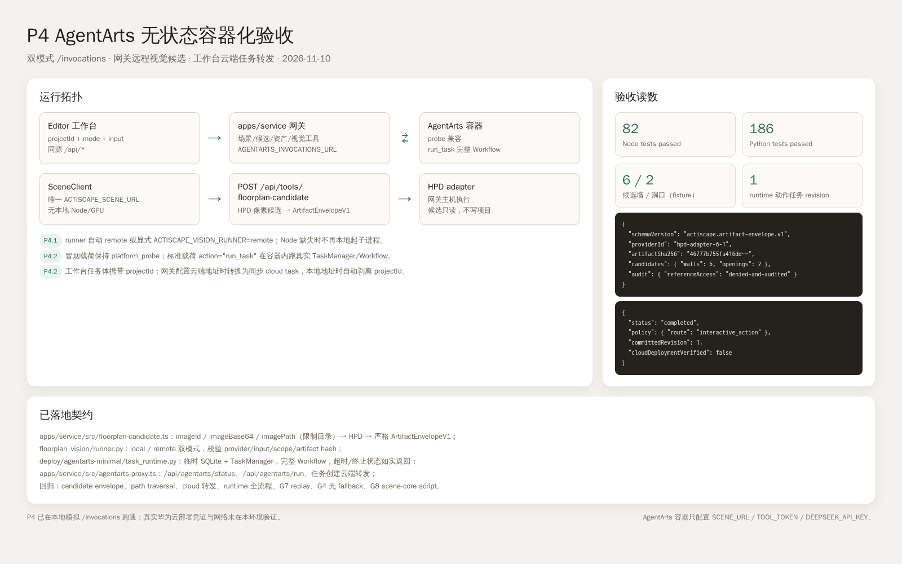

# P4 华为云 AgentArts 无状态容器化阶段验收（2026-11-10）

> 验收口径：用户只看最终展示成果；代码、契约、测试与设计由执行 Agent 自验收。
> 本阶段完成的是**可部署的运行时与网关契约**；真实华为云账号、凭证、网络与平台侧部署仍需在用户环境中验证。

## 1. 结论

P4 已完成并通过本地模拟验收：

- `POST /api/tools/floorplan-candidate` 已在 `apps/service` 落地，返回严格 `ArtifactEnvelopeV1`；
- `floorplan_vision/runner.py` 支持 `local / remote` 双模式；设置 `ACTISCAPE_VISION_RUNNER=remote` 或容器内无 `node` 时自动走网关；
- `deploy/agentarts-minimal/agent.py` 保持原有 `platform_probe` 冒烟兼容，并新增 `action="run_task"` 完整多智能体 Workflow；
- `apps/service` 支持 `AGENTARTS_INVOCATIONS_URL`：标准任务可由网关转换为同步 cloud task；本地模式自动剥离 `projectId`，不破坏原 TaskInput；
- 专项测试覆盖：候选 envelope、路径穿越拒绝、远端 runner、AgentArts 全流程、云端转发、probe 兼容。

**边界：本环境没有真实华为云 AgentArts 部署凭证，`cloudDeploymentVerified=false`。** 本地 `/invocations` 模拟已跑通，不能宣称真实云端已部署。

## 2. 最终展示



补充证据：

- [候选 envelope JSON](evidence/p4-agentarts-20261110/candidate-envelope.json)
- [AgentArts runtime 全流程结果](evidence/p4-agentarts-20261110/runtime-run.json)
- [platform-probe 输入](evidence/p4-agentarts-20261110/platform-probe-input.json)
- [G3 地面开启包络线框](evidence/p4-agentarts-20261110/g3-open-envelope.png)
- [无 Node 运行时动作任务](evidence/p4-agentarts-20261110/no-node-runtime-run.json)
- [无 Node 运行时照片任务](evidence/p4-agentarts-20261110/no-node-photo-run.json)
- [无 Node 运行时 ping/PATH](evidence/p4-agentarts-20261110/no-node-runtime-ping.txt)
- [工作台 → 云端运行时转发](evidence/p4-agentarts-20261110/cloud-proxy-run.json)

## 3. P4.1 去 Node 依赖与远程视觉候选

### 3.1 新增网关端点

`apps/service/src/floorplan-candidate.ts`：

- `POST /api/tools/floorplan-candidate`
- 输入三选一：
  - `imageId`：读取已入库户型图原图；
  - `imageBase64`：PNG/JPEG，≤20MB；
  - `imagePath`：只允许 `ACTISCAPE_FLOORPLAN_SOURCE_ROOT`（默认 `data/floorplan-images`）下；
- 在 Node 网关侧调用 pinned HPD 像素适配器（底层沿用仓库现有 Python HPD 实现）；
- 输出严格 `ArtifactEnvelopeV1`：provider、input sha、scope hash、artifact、artifact sha；
- 候选只读，不写项目/草稿/历史；路径穿越与畸形图片明确 422。

### 3.2 runner 双模式

`apps/agent/actiscape_agent/floorplan_vision/runner.py`：

- `ACTISCAPE_VISION_RUNNER=remote` 强制远端；
- `=local` 强制本地；
- 未设置时：`shutil.which("node")` 为空（AgentArts 纯 Python 容器）自动远端；
- 远端通过 `httpx.Client(trust_env=False)` 调 `ACTISCAPE_SCENE_URL + /api/tools/floorplan-candidate`；
- 校验 `providerId`、`inputSha256`、`scopeHash`、`artifactSha256`，不一致直接 failed；
- 可选 `output_dir` 写出 `candidate-envelope.json`；
- 远端不可用/非 2xx/非法 envelope 都返回 `ProviderRunRecord(status="failed")`，不静默回退本地。

### 3.3 证据

- 网关 fixture 实测：`hpd-adapter-6-1`，1000×800，6 段墙、2 个洞口，artifact hash `46777b75…`；
- `test_floorplan_vision_provider.py::test_remote_runner_uses_gateway_envelope_and_never_spawns_node` 通过；
- `tests/floorplan-candidate.test.ts` 通过；
- `npm test` 82 passed。

## 4. P4.2 AgentArts 完整 Workflow 与工作台转发

### 4.1 `run_task` 运行时

新增 `deploy/agentarts-minimal/task_runtime.py`：

- `run_task(payload, manager=None, timeout=None)`；
- 在临时目录创建 SQLite TaskStore + `TaskManager`（无状态容器，不依赖本地持久盘）；
- 标准载荷：`projectId / mode / input / selectedIds / imageId / assetId / hostId / requestId`；
- 调用真实 `Workflow`，轮询到终态，返回 `status / taskId / result / error / generation`；
- 超时/取消/失败如实返回，不冒充成功；
- `agent.py` 的 `/invocations`：
  - `action="probe"` 或包含 `originalX/targetX` → 原 probe 图；
  - `action="run_task"` 或含 `projectId+input` 且无 probe 字段 → `run_task`；
- Dockerfile 同步复制 `task_runtime.py`。

### 4.2 工作台云端转发

`apps/service/src/agentarts-proxy.ts` + `agent-proxy.ts`：

- `GET /api/agentarts/status`：返回是否配置云端；
- `POST /api/agentarts/run`：直接转发到 `AGENTARTS_INVOCATIONS_URL`；
- 配置云端时，`POST /api/agent/conversations/:id/tasks` 携带 `projectId` 会被转换为同步 cloud task；
- 本地模式自动删除 `projectId`，保持原 Agent TaskInput 严格契约；
- 云端任务返回 `cloud:true`，字段 shape 兼容现有 ChatPanel。

**当前限制**：云端转发是同步完成，不实现云端 SSE/resume；长任务等待受 `AGENTARTS_TASK_TIMEOUT`（默认 240s）限制。真实生产建议用 AgentArts 异步任务/轮询，而不是浏览器长连接。

### 4.3 证据

- `test_agentarts_runtime.py`：真实 `TaskManager + Workflow` 动作任务 → completed，revision 0→1；
- `test_agentarts_runtime.py`：`agent.py` handler 路由 `run_task`，不触发 probe 校验；
- `tests/agentarts-proxy.test.ts`：本地模拟 `/invocations`，网关转发并返回 cloud task；
- `node scripts/platform-probe.mjs --prepare-only`：通过，probe 载荷不变。

### 4.4 P4 走查修复（2026-11-10 追加）

1. **本地代理 `projectId` 剥离 Bug**：`agent-proxy.ts` 的本地 fetch 已改为发送 `localBody`，不再把 `projectId` 透传给 Python `TaskInput/ResumeInput`；新增本地 tasks/resume 转发断言。
2. **cloud task 误监听**：`watchActive()` 对 `task.cloud === true` 直接关闭旧 EventSource 并返回，不再请求不存在的本地 SSE。
3. **floorplanScope 透传**：`task_runtime._body` 现在保留 `floorplanScope`，AgentArts `run_task` 的户型图任务参数不丢失。
4. **G3 包络线框**：`three-view.ts` 在柜体开启或选中时绘制地面半透明包络；冲突显示橙红，正常显示青绿。
5. **G5/G6 FastExec + 最小避让**：策略支持单件平移/旋转/改色；`OPENABLE_FRONT_BLOCKED` 时按 `clearance - remaining + 50mm` 移开阻挡物并重新走 Candidate → CheckScene → Commit。
6. **G2 确定性布局**：`deterministic_layout.py` 复用 6 类房间的 positive L3 模板，模型失败时缩放坐标生成候选；过道使用通用安全布局；fake-model 测试覆盖。

### 4.5 无 Node 运行时实测（本环境无 Docker）

本环境没有 Docker/Podman，无法真正构建 `python:3.13-slim` 镜像；采用**等效无 Node 宿主进程**验证：

- 运行时进程 `PATH=/tmp/no-node-bin:/usr/bin:/bin`，其中没有 `node`；
- `GET /ping` → `{"status":"Healthy"}`；
- `POST /invocations` `run_task` 动作任务 → **completed**，revision 2→3；
- 照片任务 → **waiting_input**（真实台面碰撞，未写正式项目），证明照片路径也进入完整 Workflow；
- `cloud-proxy-run.json`：工作台网关 3014 → AgentArts 运行时 8090 → 场景服务 3013，cloud task **completed**，revision 4→5。

**这不是完整容器验收**：Dockerfile 构建、容器网络、平台 `/ping` 生命周期仍需在有 Docker/华为云的环境复跑。真实华为云部署仍未完成。

### 4.6 上云前置改造（2026-11-10 追加）

- `deploy/agentarts-minimal/app.py`：官方 CLI `app:app` 别名；`agent.py` 同时读取 `AGENT_RUN_PORT` / `RUNTIME_PORT`。
- `config.py` / `model.py`：兼容 `MODEL_API_KEY` / `MODEL_URL` / `MODEL_NAME`；MaaS 非 DeepSeek 地址默认不发送 `extra_body.thinking`。
- `apps/service`：可选 `ACTISCAPE_TOOL_TOKEN` Bearer 鉴权，未设置时本地免密；保护 `/api/*`，健康检查例外。
- `npm run build:agentarts-bundle`：生成自包含 `dist/agentarts-bundle/`（33 Skills、requirements、Dockerfile、runbook、config example）。
- 详细决策：[AGENTARTS_DEPLOYMENT_DECISION_20261110.md](AGENTARTS_DEPLOYMENT_DECISION_20261110.md)。

## 5. 验收命令

```bash
npm test
# 82 passed / 0 failed

PYTHONPATH=apps/agent .venv/bin/python -m pytest apps/agent/tests -q
# 186 passed

npm run build
# typecheck + vite build 通过

npm run test:all
# exit 0（baseline / browser / parity / catalog / visual）

npm run test:skill-pool:v1
# exit 0（13 active skills / 26 cases）

node scripts/platform-probe.mjs --prepare-only
# Prepared disposable project and test-results/platform-probe/input.json
```

## 6. 已知边界

1. **真实华为云未部署**：本环境无 AgentArts 凭证/网络，`cloudDeploymentVerified=false`；只验证了 SDK 运行时与本地 `/invocations` 模拟。
2. **HPD 仍是 Python 实现**：网关侧 Node 服务负责 HTTP 契约、隔离和 artifact seal；实际像素适配器沿用仓库现有 Python HPD，不在 AgentArts 容器内。
3. **云端转发同步**：未实现 SSE/resume/异步任务表；长任务可能触碰平台 60–300s 超时。
4. **证据文件未随 envelope 返回**：远端 envelope 只含候选与哈希，证据 PNG 由网关隔离保存；如需下载需补独立只读路由。
5. **未做真实 V100**：P2.1 仍是外部依赖。

## 7. 关键文件

- [`floorplan-candidate.ts`](../apps/service/src/floorplan-candidate.ts)
- [`floorplan-routes.ts`](../apps/service/src/floorplan-routes.ts)
- [`runner.py`](../apps/agent/actiscape_agent/floorplan_vision/runner.py)
- [`task_runtime.py`](../deploy/agentarts-minimal/task_runtime.py)
- [`agent.py`](../deploy/agentarts-minimal/agent.py)
- [`agentarts-proxy.ts`](../apps/service/src/agentarts-proxy.ts)
- [`agent-proxy.ts`](../apps/service/src/agent-proxy.ts)
- 测试：[`test_floorplan_vision_provider.py`](../apps/agent/tests/test_floorplan_vision_provider.py)、[`test_agentarts_runtime.py`](../apps/agent/tests/test_agentarts_runtime.py)、[`floorplan-candidate.test.ts`](../tests/floorplan-candidate.test.ts)、[`agentarts-proxy.test.ts`](../tests/agentarts-proxy.test.ts)
