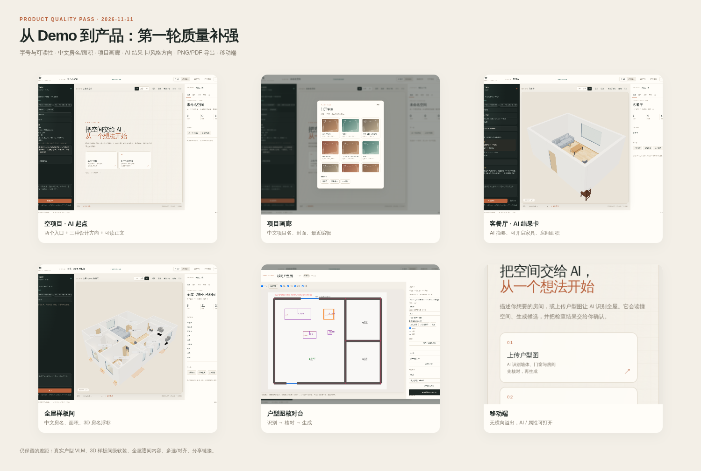
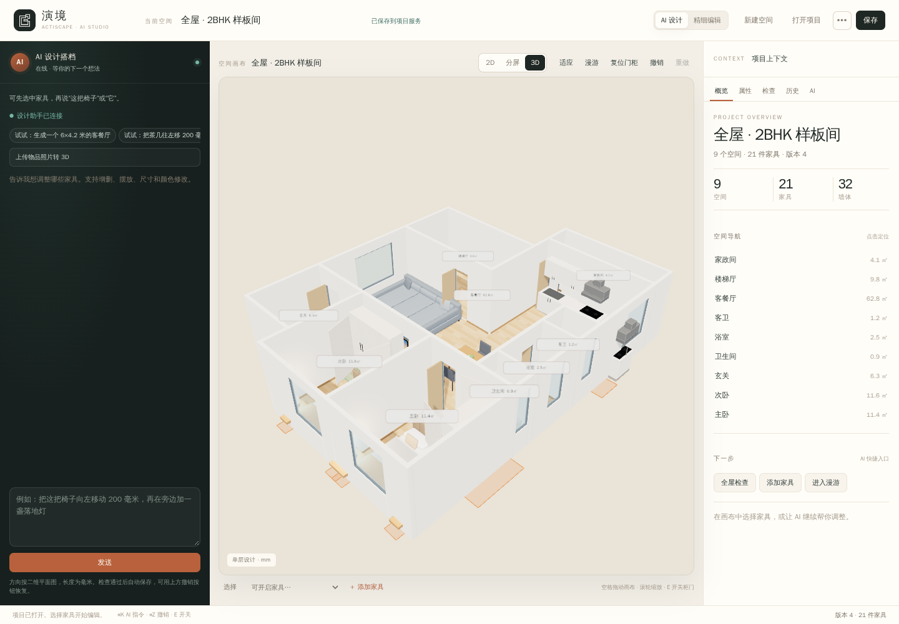
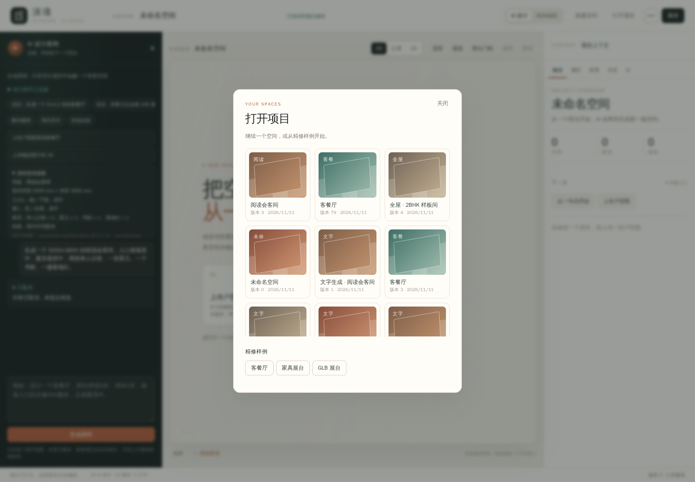
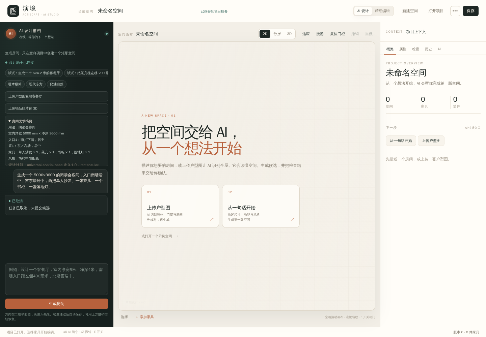
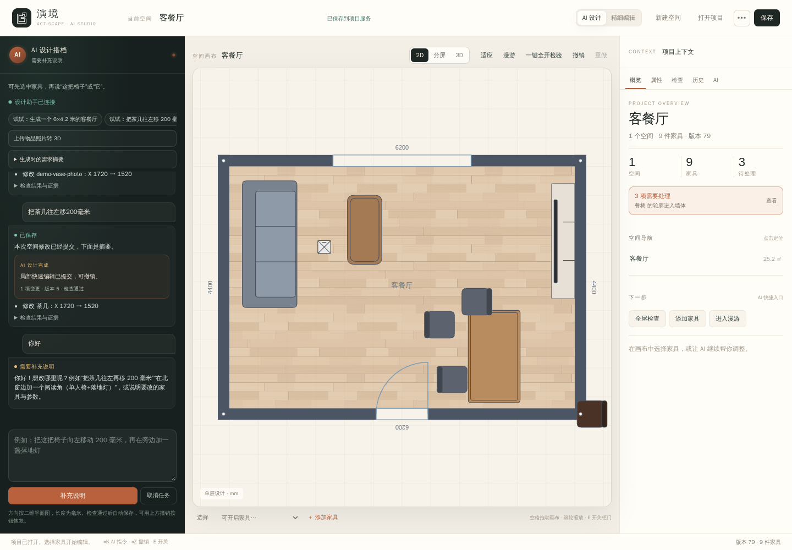
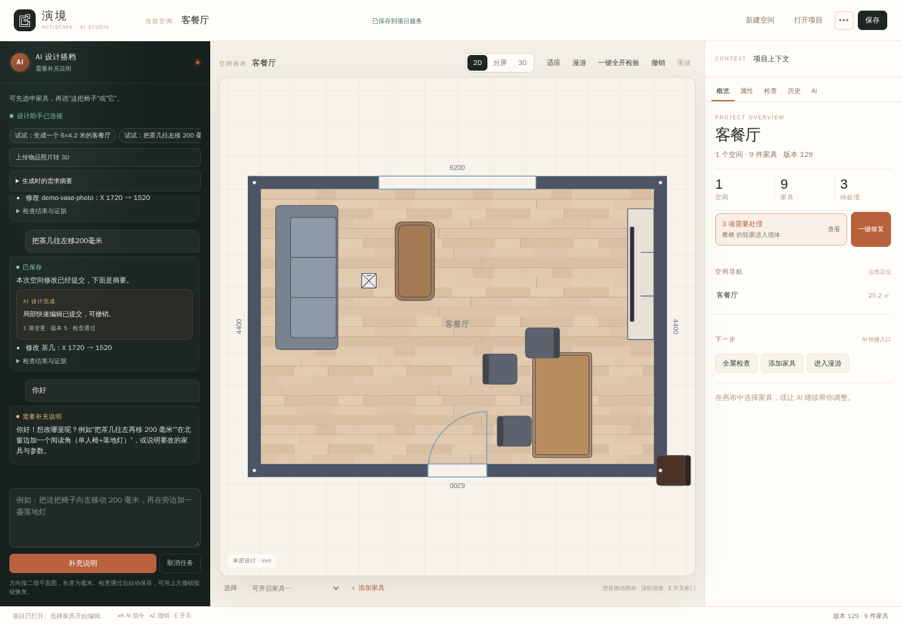
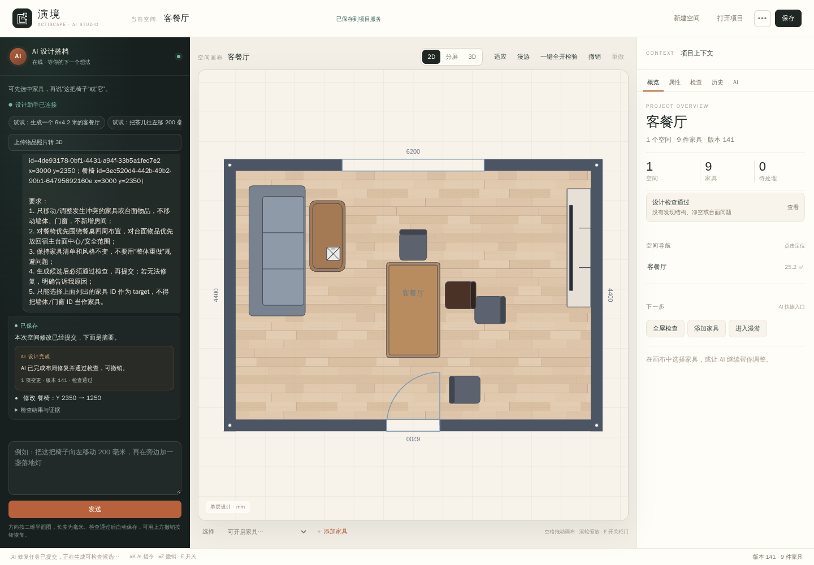
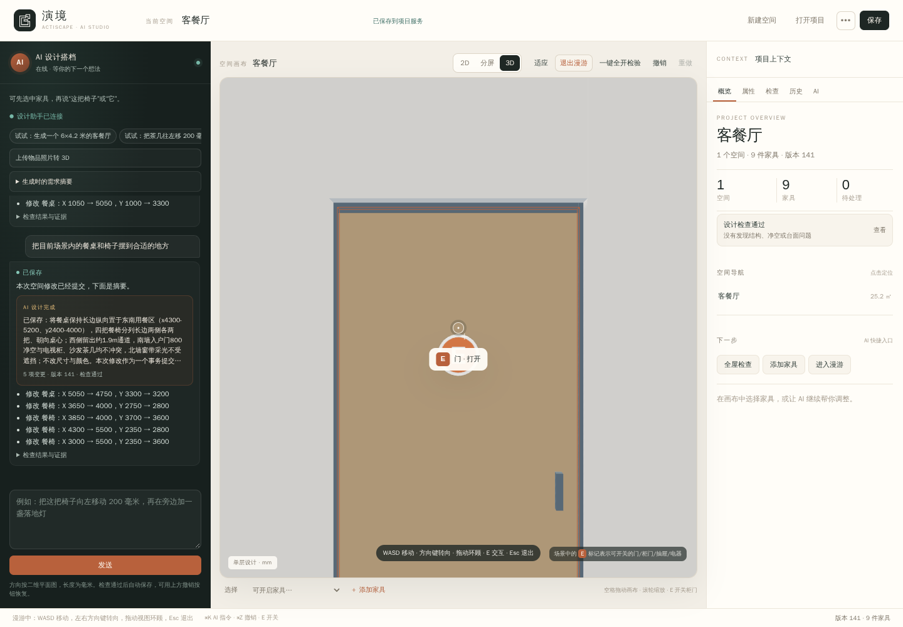

# 产品体验审查与第一轮质量补强

## 1. 严格结论

以普通装修业主的视角，审查“是否高级、完善、愿意继续使用”。

**改造前：约 5.0 / 10。**

- 有 AI Studio 外壳和完整技术链路，但像“功能很全的内部 Demo”；
- 3D 白墙盒子、聊天日志墙、开发术语、英文房名、空项目引导不足；
- 用户能生成，但不容易感到“这是一个值得信赖的设计产品”。

**本轮后：约 6.5 / 10。**

明显更像产品，但仍未达到“样板间级、全屋完整、可对外交付”的 8 分标准。



## 2. 审查关注点

普通业主真正关心：

1. 第一眼是否可信、是否高级；
2. 不懂 CAD 也能不能快速开始；
3. AI 是否像设计师，能主动建议、解释、给选择；
4. 结果是否像真实可住的空间；
5. 全屋是否完整、每个房间是否有内容；
6. 能否控制、撤销、保存、分享和导出；
7. 字号、对比度、移动端是否可用。

专业设计师才会额外关心：多选、对齐、尺寸链、结构编辑、批量替换、施工图。当前产品应优先服务前者。

## 3. 本轮实际修复

### 3.1 可读性与产品文案

- 全局字号上调，默认可见按钮中低于 11px 的数量从 **305 降到约 12**；
- AI 舱、项目上下文、目录、属性区的辅助文字统一提高到可读范围；
- 隐藏聊天中的默认技术细节，改为“AI 设计完成 / 变更数量 / 检查通过”摘要卡；
- 技术依据折叠到“AI 设计依据”。

### 3.2 中文内容与面积



- 项目名从 `Evaluation only: 2BHK bungalow development reference` 显示为 **“全屋 · 2BHK 样板间”**；
- 房名从 `UTILITY / ENT. LOBBY / BED ROOM` 映射为家政间、玄关、次卧、主卧等；
- 右侧空间导航显示面积，例如客餐厅 62.8㎡、主卧 11.4㎡；
- 全屋 3D 加入房名 + 面积浮标。

### 3.3 项目画廊



- 项目列表改为封面卡片，显示中文项目名、版本和最近编辑日期；
- 空项目不再全部堆进画廊；
- 精修样例入口保留。

### 3.4 AI 舱



- 空项目增加三种设计方向：**暖木极简 / 现代东方 / 奶油自然**；
- 方向会进入生成提示，而不是纯装饰按钮；
- 修复 `waiting_input` 状态误显示“等待你核对户型草稿”的 bug：
  - 只有户型图任务才显示核对；
  - 普通补充说明显示“需要补充说明”；
- AI 完成结果变为摘要卡，不再默认展示 skill 版本和事务日志。

### 3.5 设计健康状态

- 概览新增待处理项数量与第一条问题，例如“餐椅轮廓进入墙体”；
- 点击直接打开检查面板；
- 当前 A 项目有 3 项待处理，工作台不再假装“没有问题”。



### 3.6 一键修复



- 点击“一键修复”不再执行浏览器坐标搜索，而是创建一个 `repair_layout` Agent 任务；
- 任务输入包含问题描述、对象名/ID/当前位置和安全约束；
- PolicyController 路由到编辑工作流，Agent 生成候选，经过 CheckScene/截图检查后提交；
- 不再直接调用 `/commands`，修复动作也进入多 Agent 链路；
- 修复会显示在 AI 舱，用户可撤销；
- 副本实测：餐桌与餐椅重叠 → Agent 只把冲突餐椅移到餐桌北侧，餐桌保持原位，revision +1，健康检查通过；
- 任务经历理解需求 → 生成候选 → 检查视图 → 提交，AI 舱记录完成摘要。



### 3.6.1 3D 漫游交互提示

- 进入漫游后出现准星、操作说明和退出方式；
- 可开关的门/窗/柜门/抽屉/电器显示铜色 `E` 标记；
- 看向可交互对象时，屏幕中央显示对象名 + `E 打开/关闭`，并用框高亮；
- 切出漫游后 HUD 和标记自动隐藏。



### 3.7 导出

“更多操作”新增：

- 导出当前视图 PNG；
- 打印 / 保存为 PDF；
- 原 JSON 导出保留。

### 3.8 空项目上下文

空项目不再显示无意义的“全屋检查 / 进入漫游”，而是：

- 从一句话开始；
- 上传户型图。

## 4. 仍然不达标的地方

这些问题没有被本轮掩盖：

1. 一键修复现在已进入 Agent 工作流，但仍复用编辑工作流，不是专门的“布局修复子图”；它会生成候选并检查，但不保证风格/动线最优。
2. 还没有提交前的“方案对比”；Agent 修复是单候选自动提交。
3. **真实户型图 VLM 仍不可用**：`visionAvailable=false`，真实上传无法可靠工作。
4. **全屋内容仍不完整**：B 是冻结样例，若干房间空置，没有逐间布置。
5. **3D 还不够高级**：缺少地毯、挂画、绿植、窗帘、灯光层次、踢脚线/顶面细节，仍偏白墙盒子。
6. **AI 还没有 2–3 个方案对比**：现在只有“设计方向提示”，没有提交前方案预览/对比。
7. **没有分享链接**：只有 PNG/PDF/JSON。
8. **项目封面是抽象封面**，不是实际渲染缩略图。
9. **多选、对齐、分布、批量替换、尺寸标注**仍缺。
10. **移动端 3D 编辑**仍以查看和常用操作为主。

## 5. 测试

```text
Node: 82 passed
Python: 187 passed
test:all: EXIT 0
test:browser: PASS
test:generation:browser: PASS
test:floorplan: PASS
test:ui:redesign: PASS
1440 / 1024 / 390: 无横向溢出
```

## 6. 下一轮建议

优先级从高到低：

1. 真实 VLM 或明确的“识别示例库”，解决户型图硬缺口；
2. 全屋逐间布置 + 样板间级软装/灯光；
3. AI 方案对比（2–3 个布局/风格方向，提交前选择）；
4. 项目封面改为真实渲染缩略图，分享链接；
5. 多选/对齐/批量替换/尺寸标注。

本轮完成的是“从内部 Demo 到可展示产品”的第一步，不是最终完成态。
