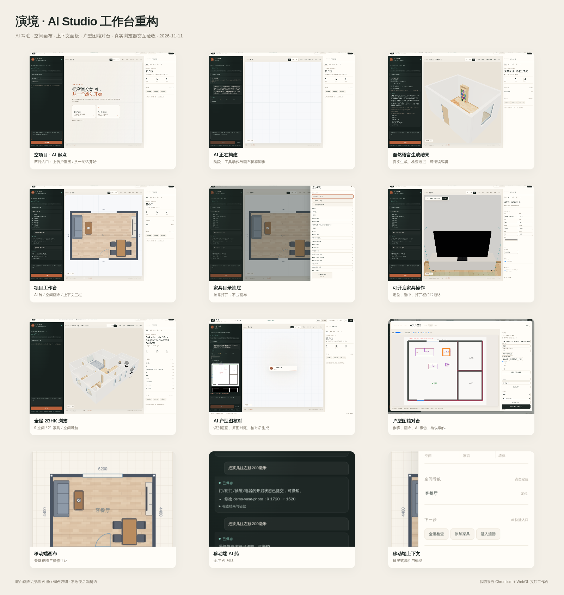
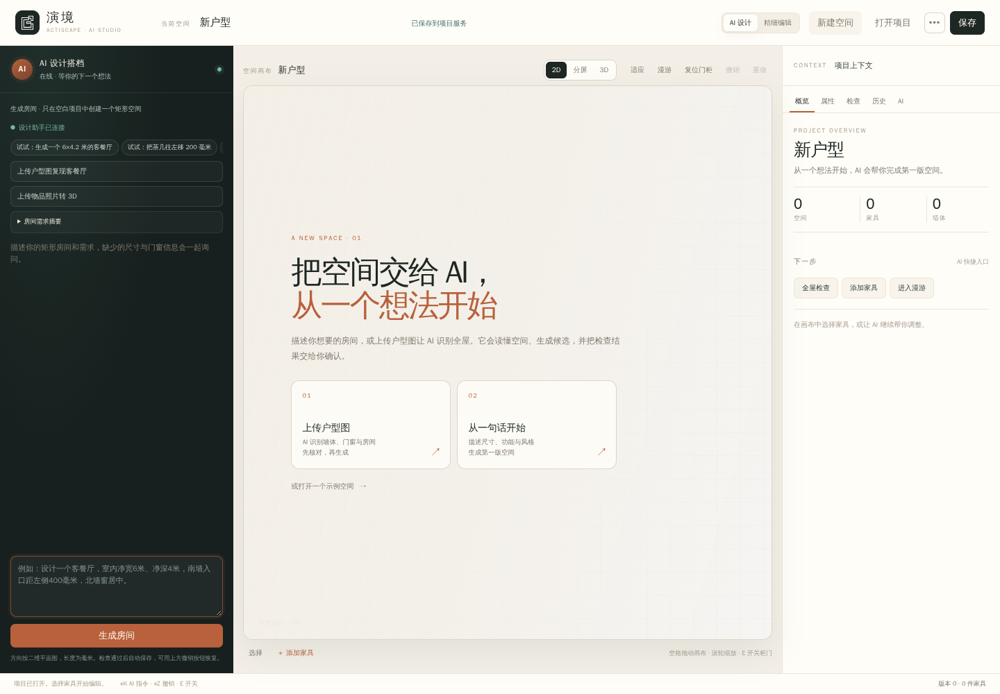
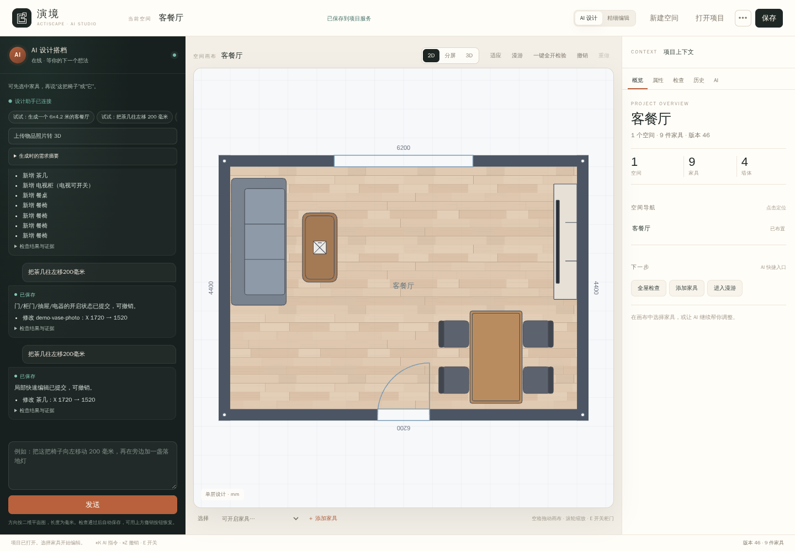
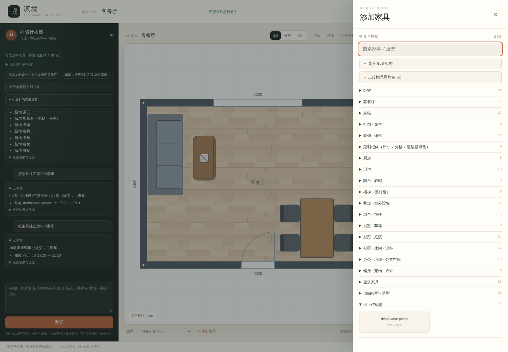
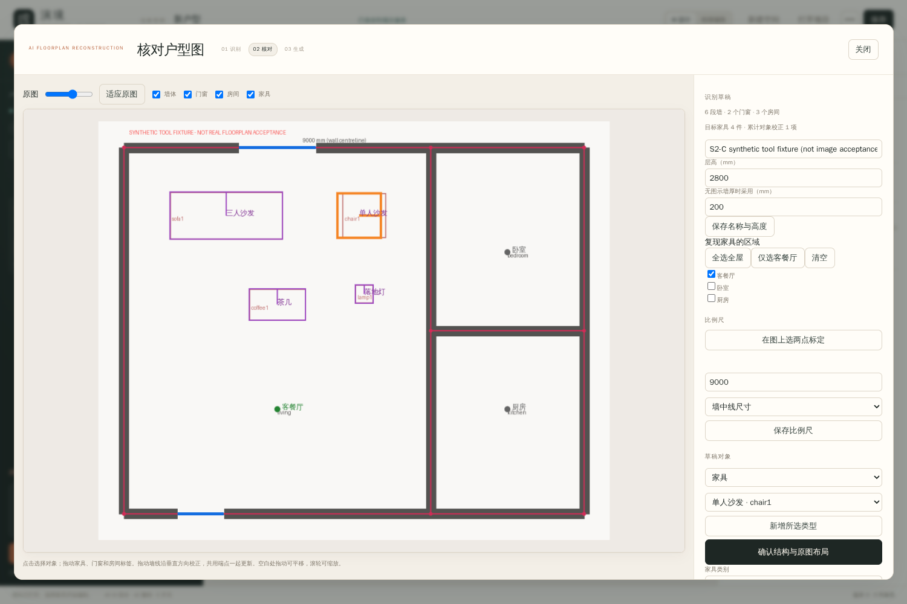

# 工作台重构：AI Studio（2026-11-11）

## 1. 为什么改

旧工作台是“功能齐全的 CAD 工具”，但不是“AI 空间设计产品”：

- 顶部两层工具条 + 左侧 266 件家具库 + 右侧属性栏，把画布和 AI 挤到边缘；
- 生成进度藏在右侧“对话”标签，AI 像附属功能；
- 户型图核对是一个原始表单弹窗，缺少 AI 叙事和步骤；
- 通用灰蓝/青绿色、13px 字号、等权按钮，没有品牌层级。

这次不是换皮，而是重排信息架构：**AI 常驻、画布优先、工具按需出现**。

## 2. 设计方向

**Architectural Atelier / AI Studio**

- 暖纸色画布 `#F3EFE7` + 深墨 AI 舱 `#17201E` + 铜色 `#B8613C`；
- 玉色表示检查通过 `#3F6F66`；
- 8/14/22px 圆角层级，轻阴影、细分隔线；
- 中文系统字体 + 英文 Avenir/Helvetica 回退，不加载外部字体；
- 全部图标内联 SVG，无图标库；
- 动效 160–240ms，`prefers-reduced-motion` 降级。



## 3. 新信息架构

```text
顶栏：品牌 / 当前空间 / 自动保存 / AI 设计·精细编辑 / 新建·打开·保存
┌──────────────┬──────────────────────────────┬──────────────┐
│ AI 设计搭档   │ 空间画布                      │ 项目上下文    │
│ 状态+阶段     │ 2D / 分屏 / 3D + 浮动操作      │ 概览/属性/    │
│ 对话+建议     │ 选中条 + AI busy 状态          │ 检查/历史     │
│ 输入+附件     │ 空间导航 + 底部工具             │               │
└──────────────┴──────────────────────────────┴──────────────┘
```

### AI 舱

- 常驻左侧，不再挂在右侧标签里；
- 新建项目自动聚焦输入框；
- 显示 AI 在线状态、当前阶段、最近任务；
- 任务卡显示阶段轨（理解 → 生成 → 检查 → 保存）；
- 历史任务默认只展示最近 4 条，避免聊天墙；
- 快捷建议可一键填入输入框；
- 户型图上传、照片转 3D 在 AI 舱内完成。

### 空项目



两个主入口：

1. **上传户型图**：AI 识别墙体、门窗、房间，先核对再生成；
2. **从一句话开始**：描述尺寸、功能和风格，生成第一版房间。

### 画布



- 画布占据中心，2D/分屏/3D 为浮动视图切换；
- 结构工具默认隐藏，切到“精细编辑”才出现；
- 选中家具后左上角出现对象操作条，可直接打开/关闭柜门；
- “可开启家具”定位器自动聚焦电视柜/衣柜等可开启对象；
- AI 工作时画布中央显示“AI 正在构建空间 + 当前阶段”。

### 项目上下文

- 默认“概览”：空间数、家具数、墙体数、空间列表、AI 快捷入口；
- 选中家具自动切“属性”；
- 检查/历史复用原 API；
- 多空间项目可在概览中点击房间定位。

### 家具目录



- 从“添加家具”打开右侧抽屉；
- 搜索、分类、已有模型、GLB 导入、照片转 3D 都在抽屉内；
- 不打开时不占画布。

### 精细编辑

- AI 设计模式只保留高频动作；
- 切到精细编辑后，墙体/门/窗/柱/梁/房间/尺寸工具才出现；
- 不删除能力，只做渐进披露。

### 户型图核对台



- 顶部步骤：识别 → 核对 → 生成；
- 左侧大画布看原图、墙线、家具和待确认项；
- 右侧 AI 识别报告、尺寸标定、对象校正；
- 底部始终可确认结构与原图布局；
- 逻辑和 API 未改，仍是 draft-only，确认前不写正式项目。

## 4. 代码改动

- `apps/editor/src/style.css`：新设计系统、三栏外壳、AI 舱、空状态、目录抽屉、上下文、响应式；
- `apps/editor/src/main.ts`：新壳层、模式切换、空状态、目录、空间导航、概览、AI 状态；
- `apps/editor/src/ui/chat.ts`：常驻 AI 舱、快捷建议、阶段轨、最近任务、活动回调；
- `apps/editor/src/ui/floorplan.ts`：核对台标题/步骤；
- `apps/editor/src/views/three-view.ts`：暖色场景、点击/拖动阈值、房间聚焦；
- `apps/editor/src/views/plan-view.ts`：暖色画布、房间居中；
- `scripts/browser-acceptance.mjs`：适配目录抽屉和精细编辑入口。

## 5. 验收结果

真实 Chromium/WebGL 跑过：

- 自然语言新建 → 生成阅读会客间 → revision 0→1；
- 受控 agent 户型图上传 → waiting_input → 核对台 → 确认生成；
- 3D 可开启家具定位、打开/关闭柜门、包络；
- 漫游进入/退出、WASD；
- 撤销（mutation 响应直接刷新，去掉一次 GET）；
- 目录抽屉、精细编辑、空状态；
- 1440 / 1024 / 390 布局无页面级横向滚动。

测试：

```text
Node: 82 passed
Python: 187 passed
test:browser: PASS（16 个浏览器验收步骤）
test:generation:browser: PASS（新建 → 澄清 → 四角色生成 → SSE → 撤销/重做）
test:floorplan: PASS（上传 → 核对台 → 标定/拖动 → 原子提交 → 撤销/恢复）
test:ui:redesign: PASS（空状态 / 目录 / 精细编辑 / 390px 无横向溢出）
test:all: EXIT 0
```

## 6. 边界

- 户型图实时 VLM 仍受本机视觉服务限制；测试用受控 agent + fixture 验证 UI/提交链路；
- 全屋 2BHK 使用冻结样例；
- 照片仍是 demo 资产，不是真实 V100；
- 未改变后端 API、Agent 协议、scene-core schema；
- 移动端优先保证查看、选择、AI 对话和常用动作，不追求完整 CAD 精度。
