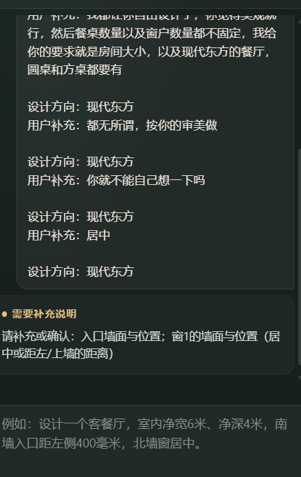

# 问题记录：自由设计授权未被正确识别，导致反复补问

- 记录日期：2026-11-13。
- 来源：用户实际使用工作台时提供的对话与截图。
- 状态：已记录，待定位和修复；本记录未执行代码修复或重新生成。
- 范围：自然语言生成房间的需求理解、设计授权和澄清策略。

## 用户需求

用户要求生成一个 20 米 × 10 米的现代东方餐厅，有东方元素，餐桌同时包含圆桌和方桌，并明确表示“其余你看着布置，要求美观，风格符合我的要求”。

后续又多次补充：“需要有窗户，但是位置你看着办”“餐桌数量以及窗户数量都不固定”“都无所谓，按你的审美做”“你就不能自己想一下吗”，最后尝试回答“居中”。

明确的硬要求是：房间大小、现代东方餐厅、圆桌与方桌同时存在、需要窗户。用户将家具数量、窗户数量与位置、其余布局交由系统设计；没有给出入口的固定位置。

## 实际表现

系统仍要求：

> 请补充或确认：入口墙面与位置；窗1的墙面与位置（居中或距左／上墙的距离）

任务没有顺利转入方案生成。截图中还反复出现“设计方向：现代东方”和累计的“用户补充”文本；记录该现象，尚不确定是输入拼接、展示逻辑还是需求解析造成。

## 影响与预期

用户已经授权系统自由设计，但系统仍把可以自主决定的设计项当成必须由用户提供的信息，造成多轮补问并阻断设计。这暴露出现有固定样例验收之外的交互缺口。

预期应区分“用户未说明”与“用户明确授权自行决定”：保留房间尺寸、风格、家具种类等硬约束，为已授权的数量和位置提出方案，并在需求摘要中标注为系统设计决定，允许后续修改。对于新建概念空间，门窗可在授权范围内作为设计建议；涉及既有真实建筑时，必须区分建议与已知事实，不能静默改造已有门窗。

遇到无法满足的家具类型、目录能力或房间规模，应明确说明具体限制，而不是反复追问已授权自主决定的参数。当前记录未证明圆桌／方桌、风格、数量或 200 平方米规模已经得到支持，后续需分别检查。

## 后续定位与验收建议

- 检查需求 schema、缺失字段规则和理解提示是否能表达“允许系统自行决定”的授权。
- 检查多轮补充是否正确继承硬约束、覆盖旧缺失项；避免设计方向与补充文本不断累加却不改变任务状态。
- 新增本案例：只给尺寸、风格、家具类型并授权自由设计，系统应推进方案，不重复要求固定门窗位置和家具数量。
- 对照测试：未授权自主决定时可以补问；用户明确限定的位置和数量不得被自动覆盖；无法满足时明确报告限制。
